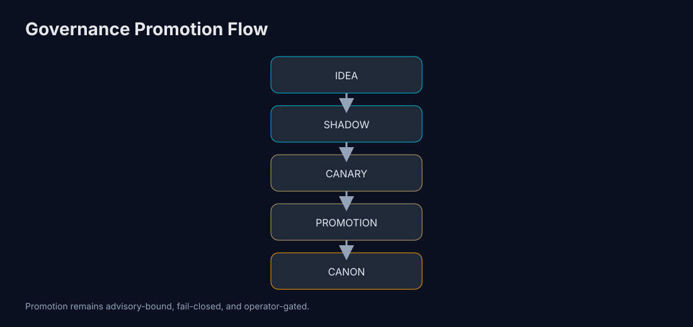
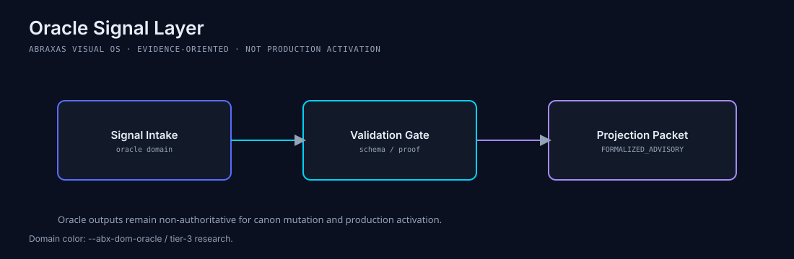
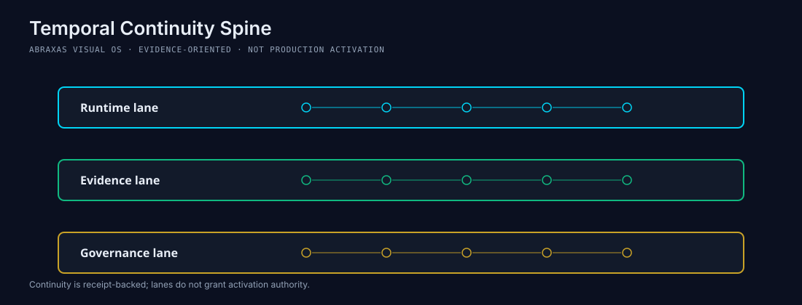
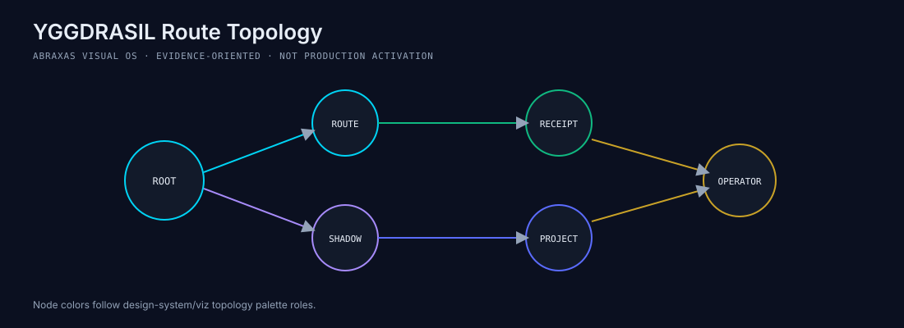
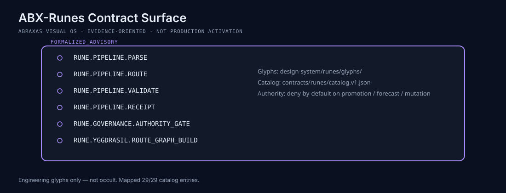
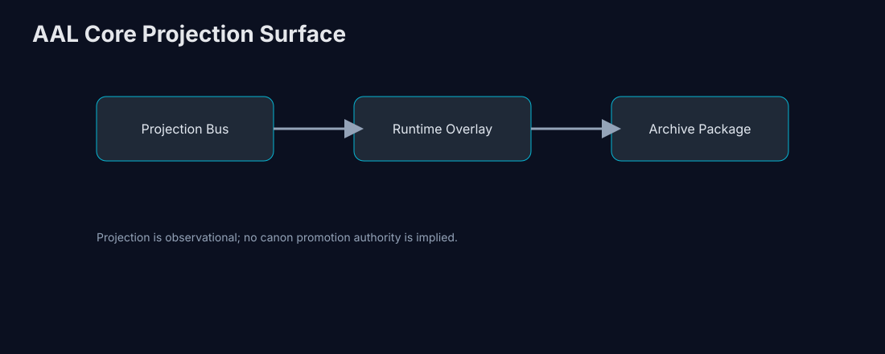

# ABRAXAS

```text
   ██████ ██████ ██████  █████ ██   ██ █████ ███████
  ███████ ███████ ███████ ███████ ███████ ███████
  ██   ██ ██   ██ ██   ██ ██   ██ ██   ██ ██   ██ ██   ██
  ██   ██ ██   ██ ██   ██ ██   ██ ██   ██ ██   ██ ██   ██
  ██   ██ ██   ██ ██   ██ ██   ██ ██   ██ ██   ██ ██   ██
   █████  ██████  ██████   █████  ██   ██  █████  ███████
```

**Governed Symbolic Intelligence**

Deterministic • Observable • Recursive


---

<details>
<summary><strong>Table of Contents</strong> (click to expand)</summary>

- [Repository Status](#repository-status)
- [Developer Workflow](#developer-workflow)
- [01. Architecture](#01-architecture)
- [02. Governance](#02-governance)
- [03. Continuity Spine](#03-continuity-spine)
- [04. Evidence Surfaces](#04-evidence-surfaces)
- [05. Routing and Rune Binding](#05-routing-and-rune-binding)
- [06. Repository Signal Surface](#06-repository-signal-surface)
- [07. System Atlas](#07-system-atlas)
- [08. Architecture Diagrams](#08-architecture-diagrams)
- [09. Repository Topology](#09-repository-topology)
- [10. Repo ↔ Notion Reconciliation](#10-repo--notion-reconciliation)
- [11. Roadmap](#11-roadmap)
- [12. Operator Paths](#12-operator-paths)
- [13. Research Domains](#13-research-domains)
- [Optimization](#optimization)
- [14. Shields / GitHub Pages](#14-shields--github-pages)
- [15. Footer](#15-footer)

</details>

---

## Repository Status

| Area                        | Status          | Last Major Change                              | Notes |
|-----------------------------|-----------------|------------------------------------------------|-------|
| CI/CD Stability             | Excellent       | Reusable workflows + cleanup of temp flags     | Very clean and efficient |
| Governance                  | Strong          | PR/Issue templates + CODEOWNERS                | Good foundation |
| Automation & Tooling        | Excellent       | organize_scripts.py + completions + release wf | Full modern DX |
| Security Posture            | Strong          | CodeQL + Dependency Review blocking            | Proper gates |
| Documentation               | Good            | Status table + STATUS.md + ToC                 | Well maintained |
| Release Process             | Started         | Reusable create-release workflow               | Foundation ready |

---

## Developer Workflow

This repo uses a governed **CLI Operator Layer** for token-efficient, evidence-first AI-assisted development across GitHub, Notion, and CLI agents (Grok, Codex, and compatible tools).

**Primary rule:** Send the AI the smallest complete evidence packet — never a full repo dump.

Full specification, operator map, Abraxas-specific command recipes, evidence-packet template, and drift-watch rules:
[`docs/workflows/cli-operator-layer.md`](docs/workflows/cli-operator-layer.md)

**Key operators include:** `rg` / `jq` / `gh` / `repomix` / `fd` / `yq` / `fzf` and others for precise scoping.

**Minimal evidence packet example:**

```bash
rg "recommended_next_lane|governance_status|canon_status|NOT_COMPUTABLE|P102G"
jq '{lane_count, highest_observed_lane, governance_status, canon_status}' docs/status/continuity-spine.json
gh pr view <PR_NUMBER> --json number,title,mergeable,headRefName,statusCheckRollup
git diff --stat
```

See also: Notion reconciliation surfaces and the full invocation order in the workflow document.

---

## 01. Architecture

Abraxas is a governed symbolic intelligence architecture for deterministic execution. It encodes computation as contract-bound artifacts, route decisions, and replay-safe evidence chains. Every meaningful surface points back to observable files, schemas, and receipts.

**Execution posture:** fail-closed.  
**Governance posture:** advisory-first, evidence-gated.  
**Routing posture:** deterministic, replayable, formalized advisory surface.

No implied authority escalation from status pages, projections, or research overlays.

```
Operator
  ↓
Oracle Signal Layer      — intake, normalization, replay-safe signal attachment
  ↓
YGGDRASIL Routing        — deterministic symbolic path control
  ↓
ABX-Runes                — contract-bound symbolic operators (24 observed)
  ↓
Governance Engine        — promotion gates, receipts, stabilization windows
  ↓
Temporal Continuity      — lane evidence, progression tracking, holds
  ↓
Artifact Registry        — deterministic evidence snapshots
```

Evidence paths:
- `contracts/runes/catalog.v1.json` — rune catalog
- `contracts/yggdrasil/routes/*.route.v1.json` — route graphs
- `contracts/pipelines/*.v1_1.json` — pipeline contracts
- `core/yggdrasil_geometric_route_metadata.py` — route metadata
- `out/audit/yggdrasil_rune_route_binding_matrix_001.latest.json` — formalized advisory binding surface

---

## 02. Governance



```
SEED → SHADOW → CANARY → PROMOTION → CANON
```

- **SEED:** candidate framing only; no execution authority.
- **ABX-Core:** symbolic runtime constrained by contract gates.
- **Shadow vs Forecast:** shadow is observational execution; forecast authority remains denied unless explicitly promoted.
- **Promotion Gates:** evidence, replay, and governance receipts required before lane transition.
- **Stabilization Windows:** convergence windows gate progression readiness.
- **12-Run Invariance:** maintain deterministic replay consistency across repeated runs.
- **Complexity Rent:** uncontrolled complexity blocks promotion readiness.

Governance evidence: `out/audit/governance_freeze_baseline_001.latest.json`  
Governance status (observed): `FROZEN` (source: `docs/status/badges.json#signals.governance_status`)  
Canon status (observed): `ADVISORY_ONLY` (source: `docs/status/badges.json#signals.canon_status`)

---

## 03. Continuity Spine

Source: `docs/status/continuity-spine.json`  
Schema: `continuity_spine_surface.v1`

| Signal | Value |
|---|---|
| Observed lane count | `58` |
| Highest observed lane | `P102G` |
| Source | `docs/status/continuity-spine.json` |

Lane progression (observed):
```
P0 • P1 • P1A • P1C • P2 • P2A • P2C • P40 • P42 • P43 • P44 • P46 • P47 •
P48 • P52 • P58 • P60 • P61 • P63 • P71 • P72 • P73 • P74 • P75 • P76 • P77 •
P78 • P79 • P80 • P81 • P82 • P83 • P84 • P85 • P86 • P87 • P88 • P89 • P90 •
P91 • P92 • P93 • P94 • P95 • P96 • P97 • P98 • P99 • P100 • P101 • P102 •
P102A • P102B • P102C • P102D • P102E • P102F • P102G
```

If continuity data is unavailable: `NOT_COMPUTABLE`.

Documentation alignment invariant (repo-visible, advisory-only):
- Continuity spine baseline remains `lane_count=58` and `highest_observed_lane=P102G`; do not merge the research-canary P103→P130 chain into the temporal-continuity lane count unless the continuity status surface explicitly changes.
- Downstream remains `NOT_COMPUTABLE` wherever explicit operator-decision evidence is missing.
- P102G remains audit-only and creates no approval record, authorization record, execution path, or downstream continuity lane.

Research canary advisory chain (separate from the temporal-continuity status baseline):
- PLANS records a repo-visible post-P130 implementation edge with advisory research-canary continuity from `P103` through `P130`.
- P130 routes to operator hold and does not authorize activation, runtime execution, scheduler mutation, canon promotion, forecast influence, or token minting.
- No P131 is introduced by the current documentation/status alignment pass.

Active handoff (P102F → P102G):
- Source lane: `operator_authorization_record_decision_reconciliation_receipt`
- Governance directives: `SEAL_RECURSIVE_AUTHORIZATION_CHAIN`, `COMPRESS_TO_GENERIC_TEMPLATE`
- Follow-up routes: `run_temporal_continuity_operator_authorization_record_decision_reconciliation_receipt.py`, `run_temporal_continuity_historical_recovery_audit.py`
- Current terminal audit: `P102G_TEMPORAL_CONTINUITY_HISTORICAL_RECOVERY_AUDIT`
- Current downstream lane: `NOT_COMPUTABLE`; explicit operator decision evidence remains required

Recursive authorization chain handoff references:
- `python scripts/run_temporal_continuity_recursive_authorization_chain_compression_audit.py`
- `out/temporal_continuity_recursive_authorization_chain_compression_audit/latest.json`
- `python scripts/run_temporal_continuity_repair_execution_plan_router.py`
- `out/temporal_continuity_repair_execution_plan_router/latest.json`
- `python scripts/run_temporal_continuity_selected_repair_execution_plan.py`
- `out/temporal_continuity_selected_repair_execution_plan/latest.json`
- do not add another hand-written recursive authorization lane after `SEAL_RECURSIVE_AUTHORIZATION_CHAIN` or `COMPRESS_TO_GENERIC_TEMPLATE`; route to the recommended post-P102 lane instead.

---

## 04. Evidence Surfaces

Generated observational surfaces — these are read-only, advisory-only outputs:

| Surface | Path | Status |
|---|---|---|
| Repository signal badges | `docs/status/badges.json` | OBSERVED |
| Continuity spine | `docs/status/continuity-spine.json` | OBSERVED |
| Repo ↔ Notion reconciliation | `docs/audits/ABRAXAS_REPO_NOTION_DIFF_001.md` | OBSERVED |
| Binding matrix audit | `docs/audits/ABRAXAS_BINDING_MATRIX_AND_COUPLING_MAP_AUDIT_001.md` | OBSERVED |
| Rune/route binding matrix | `out/audit/yggdrasil_rune_route_binding_matrix_001.latest.json` | OBSERVED |
| Coupling map | `out/audit/yggdrasil_coupling_map_001.latest.json` | OBSERVED |
| Runtime Integration Gate receipt | `out/audit/runtime_integration_gate_receipt_001.latest.json` | `RUNTIME_INTEGRATION_GATE_RECEIPT_READY_ADVISORY_ONLY` |
| Runtime Integration Gate operator review advisory spec plan | `out/audit/runtime_integration_gate_operator_review_advisory_spec_plan_001.latest.json` | `RUNTIME_INTEGRATION_GATE_OPERATOR_REVIEW_ADVISORY_SPEC_PLAN_READY` |
| Continuation frontier reconciliation | `out/audit/continuation_frontier_reconciliation_001.latest.json` | `CONTINUATION_FRONTIER_RECONCILIATION_EMITTED_ADVISORY_ONLY` |
| Governance receipt | `out/audit/governance_freeze_baseline_001.latest.json` | OBSERVED |
| Temporal continuity artifact | `out/temporal_continuity_evidence_index/latest.json` | OBSERVED |
| Controlled ingest governance audit | `out/audit/controlled_ingest_scheduler_governance_audit_001.latest.json` | OBSERVED |
| Controlled ingest scheduler operator review record | `out/operator_review/controlled_ingest_scheduler_operator_review_record_001.latest.json` | `CONTROLLED_INGEST_SCHEDULER_OPERATOR_REVIEW_ACCEPTED` |
| Auto Ingest shadow stabilization review record | `out/operator_review/abx_auto_ingest_shadow_stabilization_review_record_001.latest.json` | `ABX_AUTO_INGEST_SHADOW_STABILIZATION_REVIEW_ACCEPTED` |
| Oracle intake queue | `out/ingest/oracle_intake_queue_001.latest.json` | OBSERVED |
| Notion spec completion queue | `out/sync/notion_spec_completion_queue/latest.json` | `COMPLETION_QUEUE_EMITTED_ADVISORY_ONLY` |
| Operator decision backlog | `out/sync/notion_operator_decision_backlog/latest.json` | `OPERATOR_DECISION_BACKLOG_EMITTED_ADVISORY_ONLY` |
| Global Ingest Adapter Spine alignment plan | `out/sync/global_ingest_adapter_spine_alignment_plan/latest.json` | `ALIGNMENT_PLAN_EMITTED_ADVISORY_ONLY` |
| Oracle Signal Intake Boundary implementation plan | `out/sync/oracle_signal_intake_boundary_implementation_plan/latest.json` | `IMPLEMENTATION_PLAN_EMITTED_ADVISORY_ONLY` |
| Oracle Signal shadow intake receipt | `out/oracle/oracle_signal_intake_receipt.latest.json` | `ORACLE_SIGNAL_INTAKE_RECEIPT_EMITTED_ADVISORY_ONLY` |
| Oracle Signal shadow intake operator review request | `out/operator_review/oracle_signal_shadow_intake_operator_review_request_001.latest.json` | `ORACLE_SIGNAL_SHADOW_INTAKE_OPERATOR_REVIEW_REQUEST_HELD` |
| Oracle Signal shadow intake operator review decision record | `out/operator_review/oracle_signal_shadow_intake_operator_review_decision_record_001.latest.json` | `ORACLE_SIGNAL_SHADOW_INTAKE_OPERATOR_REVIEW_COMPLETION_APPROVED` |
| ABX Codegen merge anchor source selection request | `out/operator_review/abx_codegen_merge_anchor_source_selection_request_001.latest.json` | `ABX_CODEGEN_MERGE_ANCHOR_SOURCE_SELECTION_REQUEST_HELD` |
| ABX Codegen merge anchor source selection decision record plan | `out/operator_review/abx_codegen_merge_anchor_source_selection_decision_record_plan_001.latest.json` | `ABX_CODEGEN_MERGE_ANCHOR_SOURCE_SELECTION_DECISION_RECORD_PLAN_READY` |
| ABX Codegen merge anchor source selection decision record dry run | `out/operator_review/abx_codegen_merge_anchor_source_selection_decision_record_dry_run_001.latest.json` | `ABX_CODEGEN_MERGE_ANCHOR_SOURCE_SELECTION_DECISION_RECORD_DRY_RUN_READY` |
| ABX Codegen merge anchor source selection decision record review | `out/operator_review/abx_codegen_merge_anchor_source_selection_decision_record_review_001.latest.json` | `ABX_CODEGEN_MERGE_ANCHOR_SOURCE_SELECTION_DECISION_RECORD_REVIEW_HELD_FOR_OPERATOR` |
| ABX Codegen Phase 1 operator review request | `out/operator_review/abx_codegen_phase1_operator_review_request_001.latest.json` | `ABX_CODEGEN_PHASE1_OPERATOR_REVIEW_REQUEST_HELD` |
| ABX Codegen Phase 1 operator decision record plan | `out/operator_review/abx_codegen_phase1_operator_decision_record_plan_001.latest.json` | `ABX_CODEGEN_PHASE1_OPERATOR_DECISION_RECORD_PLAN_READY` |
| ABX Codegen Phase 1 operator decision record dry run | `out/operator_review/abx_codegen_phase1_operator_decision_record_dry_run_001.latest.json` | `ABX_CODEGEN_PHASE1_OPERATOR_DECISION_RECORD_DRY_RUN_READY` |
| ABX Codegen Phase 1 operator decision record review | `out/operator_review/abx_codegen_phase1_operator_decision_record_review_001.latest.json` | `ABX_CODEGEN_PHASE1_OPERATOR_DECISION_RECORD_REVIEW_HELD_FOR_OPERATOR` |
| ABX Codegen Phase 1 operator decision evidence collection plan | `out/operator_review/abx_codegen_phase1_operator_decision_evidence_collection_plan_001.latest.json` | `ABX_CODEGEN_PHASE1_OPERATOR_DECISION_EVIDENCE_COLLECTION_PLAN_READY` |
| ABX Codegen Phase 1 operator decision evidence collection dry run | `out/operator_review/abx_codegen_phase1_operator_decision_evidence_collection_dry_run_001.latest.json` | `ABX_CODEGEN_PHASE1_OPERATOR_DECISION_EVIDENCE_COLLECTION_DRY_RUN_READY` |
| ABX Codegen Phase 1 operator decision evidence collection validation plan | `out/operator_review/abx_codegen_phase1_operator_decision_evidence_collection_validation_plan_001.latest.json` | `ABX_CODEGEN_PHASE1_OPERATOR_DECISION_EVIDENCE_COLLECTION_VALIDATION_PLAN_READY` |
| ABX Codegen Phase 1 operator decision evidence collection validation dry run | `out/operator_review/abx_codegen_phase1_operator_decision_evidence_collection_validation_dry_run_001.latest.json` | `ABX_CODEGEN_PHASE1_OPERATOR_DECISION_EVIDENCE_COLLECTION_VALIDATION_DRY_RUN_READY` |
| ABX Codegen Phase 1 operator decision evidence collection validation dry run review | `out/operator_review/abx_codegen_phase1_operator_decision_evidence_collection_validation_dry_run_review_001.latest.json` | `ABX_CODEGEN_PHASE1_OPERATOR_DECISION_EVIDENCE_COLLECTION_VALIDATION_DRY_RUN_REVIEW_HELD_FOR_OPERATOR` |
| ABX Codegen Phase 1 operator decision evidence collection validation review evidence plan | `out/operator_review/abx_codegen_phase1_operator_decision_evidence_collection_validation_review_evidence_plan_001.latest.json` | `ABX_CODEGEN_PHASE1_OPERATOR_DECISION_EVIDENCE_COLLECTION_VALIDATION_REVIEW_EVIDENCE_PLAN_READY` |
| ABX Codegen Phase 1 operator decision evidence collection validation review evidence dry run | `out/operator_review/abx_codegen_phase1_operator_decision_evidence_collection_validation_review_evidence_dry_run_001.latest.json` | `ABX_CODEGEN_PHASE1_OPERATOR_DECISION_EVIDENCE_COLLECTION_VALIDATION_REVIEW_EVIDENCE_DRY_RUN_READY` |
| ABX Codegen Phase 1 operator decision evidence collection validation review evidence dry run review | `out/operator_review/abx_codegen_phase1_operator_decision_evidence_collection_validation_review_evidence_dry_run_review_001.latest.json` | `ABX_CODEGEN_PHASE1_OPERATOR_DECISION_EVIDENCE_COLLECTION_VALIDATION_REVIEW_EVIDENCE_DRY_RUN_REVIEW_HELD_FOR_OPERATOR` |
| PR 644 stack review receipt | `out/operator_review/pr_644_stack_review_receipt_001.latest.json` | `PR_644_STACK_REVIEW_HELD_FOR_OPERATOR_REVIEW` |
| Operator review required items bulk disposition | `out/operator_review/operator_review_required_items_bulk_disposition_001.latest.json` | `OPERATOR_REVIEW_REQUIRED_ITEMS_BULK_DISPOSITION_REVIEW_ONLY_APPROVED_WITH_HOLDS` |
| Operator review terminal hold consolidation receipt | `out/operator_review/operator_review_terminal_hold_consolidation_receipt_001.latest.json` | `OPERATOR_REVIEW_TERMINAL_HOLD_CONSOLIDATION_RECEIPT_READY` |
| v2.0 hygiene Phase 1 bulk approval reconciliation | `out/operator_review/v2_hygiene_phase1_bulk_approval_reconciliation_001.latest.json` | `V2_HYGIENE_PHASE1_BULK_APPROVAL_RECONCILIATION_HELD_FOR_OPERATOR_AUTHORIZATION` |
| v2.0 hygiene Phase 1 operator-review dependency cycle audit | `out/operator_review/v2_hygiene_phase1_operator_review_dependency_cycle_audit_001.latest.json` | `V2_HYGIENE_PHASE1_OPERATOR_REVIEW_DEPENDENCY_CYCLE_AUDIT_HELD_FOR_OPERATOR` |
| v2.0 hygiene Phase 1 operator-review stabilization strategy plan | `out/operator_review/v2_hygiene_phase1_operator_review_stabilization_strategy_plan_001.latest.json` | `V2_HYGIENE_PHASE1_OPERATOR_REVIEW_STABILIZATION_STRATEGY_PLAN_READY` |
| v2.0 hygiene Phase 1 operator-review stabilization decision-record plan | `out/operator_review/v2_hygiene_phase1_operator_review_stabilization_decision_record_plan_001.latest.json` | `V2_HYGIENE_PHASE1_OPERATOR_REVIEW_STABILIZATION_DECISION_RECORD_PLAN_READY` |
| v2.0 hygiene Phase 1 operator-review stabilization decision-record dry run | `out/operator_review/v2_hygiene_phase1_operator_review_stabilization_decision_record_dry_run_001.latest.json` | `V2_HYGIENE_PHASE1_OPERATOR_REVIEW_STABILIZATION_DECISION_RECORD_DRY_RUN_READY` |
| v2.0 hygiene Phase 1 operator-review stabilization decision-record dry run review | `out/operator_review/v2_hygiene_phase1_operator_review_stabilization_decision_record_dry_run_review_001.latest.json` | `V2_HYGIENE_PHASE1_OPERATOR_REVIEW_STABILIZATION_DECISION_RECORD_DRY_RUN_REVIEW_HELD_FOR_OPERATOR` |
| v2.0 hygiene Phase 1 stabilization review chain compression audit | `out/operator_review/v2_hygiene_phase1_stabilization_review_chain_compression_audit_001.latest.json` | `V2_HYGIENE_PHASE1_STABILIZATION_REVIEW_CHAIN_COMPRESSION_AUDIT_HELD_FOR_OPERATOR` |
| v2.0 hygiene Phase 1 stabilization operator attestation intake gate | `out/operator_review/v2_hygiene_phase1_stabilization_operator_attestation_intake_gate_001.latest.json` | `ATTESTATION_INTAKE_VALIDATED_FOR_FUTURE_DECISION_RECORD_GATE` |
| v2.0 hygiene Phase 1 stabilization decision-record gate | `out/operator_review/v2_hygiene_phase1_stabilization_decision_record_gate_001.latest.json` | `V2_HYGIENE_PHASE1_STABILIZATION_DECISION_RECORD_GATE_READY_FOR_SEPARATE_RECORD_PLANNING` |
| v2.0 hygiene Phase 1 stabilization decision-record planning receipt | `out/operator_review/v2_hygiene_phase1_stabilization_decision_record_planning_receipt_001.latest.json` | `V2_HYGIENE_PHASE1_STABILIZATION_DECISION_RECORD_PLANNING_RECEIPT_READY` |
| v2.0 hygiene Phase 1 stabilization decision-record creation gate | `out/operator_review/v2_hygiene_phase1_stabilization_decision_record_creation_gate_001.latest.json` | `V2_HYGIENE_PHASE1_STABILIZATION_DECISION_RECORD_CREATION_GATE_ELIGIBLE_FOR_SEPARATE_CREATION_PLANNING` |
| v2.0 hygiene Phase 1 stabilization decision-record creation plan | `out/operator_review/v2_hygiene_phase1_stabilization_decision_record_creation_plan_001.latest.json` | `V2_HYGIENE_PHASE1_STABILIZATION_DECISION_RECORD_CREATION_PLAN_READY` |
| v2.0 hygiene Phase 1 stabilization decision-record creation authorization gate | `out/operator_review/v2_hygiene_phase1_stabilization_decision_record_creation_authorization_gate_001.latest.json` | `V2_HYGIENE_PHASE1_STABILIZATION_DECISION_RECORD_CREATION_AUTHORIZATION_GATE_HELD_FOR_OPERATOR` |
| v2.0 hygiene Phase 1 stabilization decision-record creation authorization chain compression audit | `out/operator_review/v2_hygiene_phase1_stabilization_decision_record_creation_authorization_chain_compression_audit_001.latest.json` | `V2_HYGIENE_PHASE1_STABILIZATION_DECISION_RECORD_CREATION_AUTHORIZATION_CHAIN_COMPRESSION_AUDIT_HELD_FOR_OPERATOR` |
| v2.0 hygiene Phase 1 stabilization decision-record materialization gate | `out/operator_review/v2_hygiene_phase1_stabilization_decision_record_materialization_gate_001.latest.json` | `V2_HYGIENE_PHASE1_STABILIZATION_DECISION_RECORD_MATERIALIZATION_GATE_READY_FOR_SEPARATE_MATERIALIZATION_PLANNING` |
| v2.0 hygiene Phase 1 stabilization decision-record materialization plan | `out/operator_review/v2_hygiene_phase1_stabilization_decision_record_materialization_plan_001.latest.json` | `V2_HYGIENE_PHASE1_STABILIZATION_DECISION_RECORD_MATERIALIZATION_PLAN_READY` |
| v2.0 hygiene Phase 1 stabilization decision-record materialization authorization gate | `out/operator_review/v2_hygiene_phase1_stabilization_decision_record_materialization_authorization_gate_001.latest.json` | `V2_HYGIENE_PHASE1_STABILIZATION_DECISION_RECORD_MATERIALIZATION_AUTHORIZATION_GATE_HELD_FOR_OPERATOR` |
| v2.0 hygiene Phase 1 stabilization decision-record materialization approval intake gate | `out/operator_review/v2_hygiene_phase1_stabilization_decision_record_materialization_approval_intake_gate_001.latest.json` | `V2_HYGIENE_PHASE1_STABILIZATION_DECISION_RECORD_MATERIALIZATION_APPROVAL_INTAKE_VALIDATED_FOR_FUTURE_RECORD_EMISSION_GATE` |
| v2.0 hygiene Phase 1 stabilization decision-record emission gate | `out/operator_review/v2_hygiene_phase1_stabilization_decision_record_emission_gate_001.latest.json` | `V2_HYGIENE_PHASE1_STABILIZATION_DECISION_RECORD_EMISSION_GATE_ELIGIBLE_FOR_SEPARATE_RECORD_EMISSION_PLANNING` |
| v2.0 hygiene Phase 1 stabilization decision-record emission plan | `out/operator_review/v2_hygiene_phase1_stabilization_decision_record_emission_plan_001.latest.json` | `V2_HYGIENE_PHASE1_STABILIZATION_DECISION_RECORD_EMISSION_PLAN_READY` |
| v2.0 hygiene Phase 1 stabilization decision-record emission authorization gate | `out/operator_review/v2_hygiene_phase1_stabilization_decision_record_emission_authorization_gate_001.latest.json` | `V2_HYGIENE_PHASE1_STABILIZATION_DECISION_RECORD_EMISSION_AUTHORIZATION_GATE_HELD_FOR_OPERATOR` |
| v2.0 hygiene Phase 1 stabilization decision-record emission approval intake gate | `out/operator_review/v2_hygiene_phase1_stabilization_decision_record_emission_approval_intake_gate_001.latest.json` | `V2_HYGIENE_PHASE1_STABILIZATION_DECISION_RECORD_EMISSION_APPROVAL_INTAKE_VALIDATED_FOR_FUTURE_RECORD_EMISSION_GATE` |
| v2.0 hygiene Phase 1 stabilization decision-record finalization gate | `out/operator_review/v2_hygiene_phase1_stabilization_decision_record_finalization_gate_001.latest.json` | `V2_HYGIENE_PHASE1_STABILIZATION_DECISION_RECORD_FINALIZATION_GATE_ELIGIBLE_FOR_SEPARATE_RECORD_FINALIZATION_PLANNING` |
| Grok ABX-Runes external-work reconciliation plan | `out/operator_review/grok_abx_runes_reconciliation_plan_001.latest.json` | `GROK_ABX_RUNES_RECONCILIATION_HELD_FOR_OPERATOR` |
| Grok ABX-Runes operator decision-record plan | `out/operator_review/grok_abx_runes_operator_decision_record_plan_001.latest.json` | `GROK_ABX_RUNES_OPERATOR_DECISION_RECORD_PLAN_READY` |
| Grok ABX-Runes operator decision-record dry run | `out/operator_review/grok_abx_runes_operator_decision_record_dry_run_001.latest.json` | `GROK_ABX_RUNES_OPERATOR_DECISION_RECORD_DRY_RUN_READY` |
| Grok ABX-Runes operator decision-record review | `out/operator_review/grok_abx_runes_operator_decision_record_review_001.latest.json` | `GROK_ABX_RUNES_OPERATOR_DECISION_RECORD_REVIEW_HELD_FOR_OPERATOR` |
| Grok ABX-Runes operator decision evidence collection plan | `out/operator_review/grok_abx_runes_operator_decision_evidence_collection_plan_001.latest.json` | `GROK_ABX_RUNES_OPERATOR_DECISION_EVIDENCE_COLLECTION_PLAN_READY` |
| Grok ABX-Runes operator decision evidence collection dry run | `out/operator_review/grok_abx_runes_operator_decision_evidence_collection_dry_run_001.latest.json` | `GROK_ABX_RUNES_OPERATOR_DECISION_EVIDENCE_COLLECTION_DRY_RUN_READY` |
| Grok ABX-Runes operator review chain compression receipt | `out/operator_review/grok_abx_runes_operator_review_chain_compression_receipt_001.latest.json` | `GROK_ABX_RUNES_OPERATOR_REVIEW_CHAIN_COMPRESSED_TO_TERMINAL_HOLD` |
| v2.0 hygiene Phase 1 authorization record plan | `out/operator_review/v2_hygiene_phase1_authorization_record_plan_001.latest.json` | `V2_HYGIENE_PHASE1_AUTHORIZATION_RECORD_PLAN_READY` |
| v2.0 hygiene Phase 1 authorization record dry run | `out/operator_review/v2_hygiene_phase1_authorization_record_dry_run_001.latest.json` | `V2_HYGIENE_PHASE1_AUTHORIZATION_RECORD_DRY_RUN_READY` |
| v2.0 hygiene Phase 1 authorization record dry run review | `out/operator_review/v2_hygiene_phase1_authorization_record_dry_run_review_001.latest.json` | `V2_HYGIENE_PHASE1_AUTHORIZATION_RECORD_DRY_RUN_REVIEW_HELD_FOR_OPERATOR` |
| v2.0 hygiene Phase 1 authorization record review evidence plan | `out/operator_review/v2_hygiene_phase1_authorization_record_review_evidence_plan_001.latest.json` | `V2_HYGIENE_PHASE1_AUTHORIZATION_RECORD_REVIEW_EVIDENCE_PLAN_READY` |
| v2.0 hygiene Phase 1 authorization record review evidence dry run | `out/operator_review/v2_hygiene_phase1_authorization_record_review_evidence_dry_run_001.latest.json` | `V2_HYGIENE_PHASE1_AUTHORIZATION_RECORD_REVIEW_EVIDENCE_DRY_RUN_READY` |
| v2.0 hygiene Phase 1 authorization record review evidence dry run review | `out/operator_review/v2_hygiene_phase1_authorization_record_review_evidence_dry_run_review_001.latest.json` | `V2_HYGIENE_PHASE1_AUTHORIZATION_RECORD_REVIEW_EVIDENCE_DRY_RUN_REVIEW_HELD_FOR_OPERATOR` |
| v2.0 hygiene Phase 1 authorization record review evidence dry-run review evidence plan | `out/operator_review/v2_hygiene_phase1_authorization_record_review_evidence_dry_run_review_evidence_plan_001.latest.json` | `V2_HYGIENE_PHASE1_AUTHORIZATION_RECORD_REVIEW_EVIDENCE_DRY_RUN_REVIEW_EVIDENCE_PLAN_READY` |
| v2.0 hygiene Phase 1 authorization record review evidence dry-run review evidence dry run | `out/operator_review/v2_hygiene_phase1_authorization_record_review_evidence_dry_run_review_evidence_dry_run_001.latest.json` | `V2_HYGIENE_PHASE1_AUTHORIZATION_RECORD_REVIEW_EVIDENCE_DRY_RUN_REVIEW_EVIDENCE_DRY_RUN_READY` |
| v2.0 hygiene Phase 1 authorization record review evidence dry-run review evidence dry run review | `out/operator_review/v2_hygiene_phase1_authorization_record_review_evidence_dry_run_review_evidence_dry_run_review_001.latest.json` | `V2_HYGIENE_PHASE1_AUTHORIZATION_RECORD_REVIEW_EVIDENCE_DRY_RUN_REVIEW_EVIDENCE_DRY_RUN_REVIEW_HELD_FOR_OPERATOR` |
| v2.0 hygiene Phase 1 authorization chain compression audit | `out/operator_review/v2_hygiene_phase1_authorization_chain_compression_audit_001.latest.json` | `V2_HYGIENE_PHASE1_AUTHORIZATION_CHAIN_COMPRESSION_AUDIT_HELD_FOR_OPERATOR` |
| Oracle Confidence Calibration contract dry run | `out/sync/oracle_confidence_calibration_contract_dry_run/latest.json` | `ORACLE_CONFIDENCE_CALIBRATION_CONTRACT_DRY_RUN_READY` |
| Artifact lineage direct repair validation plan | `out/sync/abx_artifact_lineage_registry_direct_repair_validation_plan/latest.json` | `ABX_ARTIFACT_LINEAGE_REGISTRY_DIRECT_REPAIR_VALIDATION_PLAN_READY` |
| Documentation alignment receipt | `out/sync/documentation_alignment_receipt_001.latest.json` | `DOCUMENTATION_ALIGNMENT_RECEIPT_EMITTED_ADVISORY_ONLY` |
| Status regeneration receipt | `out/sync/status_regeneration_receipt_001.latest.json` | `STATUS_REGENERATION_RECEIPT_EMITTED_ADVISORY_ONLY` |
| v2.0 hygiene loop-awareness audit | `out/sync/v2_hygiene_loop_awareness_audit/latest.json` | `V2_HYGIENE_LOOP_AWARENESS_AUDIT_DEGRADED` |
| v2.0 hygiene loop-awareness alignment plan | `out/sync/v2_hygiene_loop_awareness_alignment_plan/latest.json` | `V2_HYGIENE_LOOP_AWARENESS_ALIGNMENT_PLAN_READY` |
| v2.0 live Notion surface reconciliation | `out/sync/v2_live_notion_surface_reconciliation/latest.json` | `V2_LIVE_NOTION_SURFACE_RECONCILIATION_READY_HELD_FOR_OPERATOR` |
| v2.0 upgrade completion reconciliation | `out/sync/v2_upgrade_completion_reconciliation/latest.json` | `V2_UPGRADE_COMPLETION_RECONCILIATION_READY_HELD_FOR_OPERATOR` |
| v2.0 hygiene registration readiness audit | `out/sync/v2_hygiene_registration_readiness_audit/latest.json` | `V2_HYGIENE_REGISTRATION_READINESS_AUDIT_HELD_FOR_OPERATOR` |
| v2.0 hygiene Phase 1 foundation backlog plan | `out/sync/v2_hygiene_phase1_foundation_backlog_plan/latest.json` | `V2_HYGIENE_PHASE1_FOUNDATION_BACKLOG_PLAN_READY` |
| v2.0 hygiene schema contract readiness audit | `out/sync/v2_hygiene_schema_contract_readiness_audit/latest.json` | `V2_HYGIENE_SCHEMA_CONTRACT_READINESS_AUDIT_HELD_FOR_OPERATOR` |
| v2.0 hygiene schema contract evidence request plan | `out/operator_review/v2_hygiene_schema_contract_evidence_request_plan_001.latest.json` | `V2_HYGIENE_SCHEMA_CONTRACT_EVIDENCE_REQUEST_PLAN_READY` |
| v2.0 hygiene schema contract evidence dry run | `out/operator_review/v2_hygiene_schema_contract_evidence_dry_run_001.latest.json` | `V2_HYGIENE_SCHEMA_CONTRACT_EVIDENCE_DRY_RUN_READY` |
| v2.0 hygiene schema contract evidence dry run review | `out/operator_review/v2_hygiene_schema_contract_evidence_dry_run_review_001.latest.json` | `V2_HYGIENE_SCHEMA_CONTRACT_EVIDENCE_DRY_RUN_REVIEW_HELD_FOR_OPERATOR` |
| v2.0 hygiene versioning release policy readiness audit | `out/sync/v2_hygiene_versioning_release_policy_readiness_audit/latest.json` | `V2_HYGIENE_VERSIONING_RELEASE_POLICY_READINESS_AUDIT_HELD_FOR_OPERATOR` |
| v2.0 hygiene Phase 1 acceptance checklist readiness audit | `out/sync/v2_hygiene_phase1_acceptance_checklist_readiness_audit/latest.json` | `V2_HYGIENE_PHASE1_ACCEPTANCE_CHECKLIST_READINESS_AUDIT_HELD_FOR_OPERATOR` |
| v2.0 hygiene Phase 2 module skeleton backlog plan | `out/sync/v2_hygiene_phase2_module_skeleton_backlog_plan/latest.json` | `V2_HYGIENE_PHASE2_MODULE_SKELETON_BACKLOG_PLAN_READY` |
| v2.0 hygiene Phase 2 module governance readiness audit | `out/sync/v2_hygiene_phase2_module_governance_readiness_audit/latest.json` | `V2_HYGIENE_PHASE2_MODULE_GOVERNANCE_READINESS_AUDIT_HELD_FOR_OPERATOR` |
| v2.0 hygiene Phase 2 governance evidence request plan | `out/operator_review/v2_hygiene_phase2_governance_evidence_request_plan_001.latest.json` | `V2_HYGIENE_PHASE2_GOVERNANCE_EVIDENCE_REQUEST_PLAN_READY` |
| v2.0 hygiene Phase 2 governance evidence dry run | `out/operator_review/v2_hygiene_phase2_governance_evidence_dry_run_001.latest.json` | `V2_HYGIENE_PHASE2_GOVERNANCE_EVIDENCE_DRY_RUN_READY` |
| v2.0 hygiene future phase placeholder audit | `out/sync/v2_hygiene_future_phase_placeholder_audit/latest.json` | `V2_HYGIENE_FUTURE_PHASE_PLACEHOLDER_AUDIT_READY` |
| v2.0 hygiene loop-awareness operator authorization gate | `out/operator_review/v2_hygiene_loop_awareness_operator_authorization_gate_001.latest.json` | `V2_HYGIENE_LOOP_AWARENESS_OPERATOR_AUTHORIZATION_GATE_HELD_FOR_OPERATOR` |
| v2.0 hygiene operator authorization evidence request plan | `out/operator_review/v2_hygiene_operator_authorization_evidence_request_plan_001.latest.json` | `V2_HYGIENE_OPERATOR_AUTHORIZATION_EVIDENCE_REQUEST_PLAN_READY` |
| v2.0 hygiene operator authorization evidence dry run | `out/operator_review/v2_hygiene_operator_authorization_evidence_dry_run_001.latest.json` | `V2_HYGIENE_OPERATOR_AUTHORIZATION_EVIDENCE_DRY_RUN_READY` |
| v2.0 hygiene operator authorization evidence validation plan | `out/operator_review/v2_hygiene_operator_authorization_evidence_validation_plan_001.latest.json` | `V2_HYGIENE_OPERATOR_AUTHORIZATION_EVIDENCE_VALIDATION_PLAN_READY` |
| v2.0 hygiene operator authorization evidence validation review | `out/operator_review/v2_hygiene_operator_authorization_evidence_validation_review_001.latest.json` | `V2_HYGIENE_OPERATOR_AUTHORIZATION_EVIDENCE_VALIDATION_REVIEW_HELD_FOR_OPERATOR` |
| v2.0 hygiene operator authorization evidence validation review evidence plan | `out/operator_review/v2_hygiene_operator_authorization_evidence_validation_review_evidence_plan_001.latest.json` | `V2_HYGIENE_OPERATOR_AUTHORIZATION_EVIDENCE_VALIDATION_REVIEW_EVIDENCE_PLAN_READY` |
| v2.0 hygiene operator authorization evidence validation review evidence dry run | `out/operator_review/v2_hygiene_operator_authorization_evidence_validation_review_evidence_dry_run_001.latest.json` | `V2_HYGIENE_OPERATOR_AUTHORIZATION_EVIDENCE_VALIDATION_REVIEW_EVIDENCE_DRY_RUN_READY` |
| v2.0 hygiene operator authorization evidence validation review evidence dry run review | `out/operator_review/v2_hygiene_operator_authorization_evidence_validation_review_evidence_dry_run_review_001.latest.json` | `V2_HYGIENE_OPERATOR_AUTHORIZATION_EVIDENCE_VALIDATION_REVIEW_EVIDENCE_DRY_RUN_REVIEW_HELD_FOR_OPERATOR` |
| Artifact-lineage direct repair operator decision record | `out/operator_review/abx_artifact_lineage_registry_direct_repair_operator_decision_record_001.latest.json` | `ABX_ARTIFACT_LINEAGE_REGISTRY_DIRECT_REPAIR_OPERATOR_DECISION_RECORD_APPROVED_FOR_SEPARATE_EXECUTION_SPEC` |
| Artifact-lineage direct repair separate execution spec plan | `out/operator_review/abx_artifact_lineage_registry_direct_repair_separate_execution_spec_plan_001.latest.json` | `ABX_ARTIFACT_LINEAGE_REGISTRY_DIRECT_REPAIR_SEPARATE_EXECUTION_SPEC_PLAN_READY` |
| Artifact-lineage direct repair execution authorization gate | `out/operator_review/abx_artifact_lineage_registry_direct_repair_execution_authorization_gate_001.latest.json` | `ABX_ARTIFACT_LINEAGE_REGISTRY_DIRECT_REPAIR_EXECUTION_AUTHORIZATION_GATE_HELD_FOR_OPERATOR` |
| Artifact-lineage direct repair execution authorization record | `out/operator_review/abx_artifact_lineage_registry_direct_repair_execution_authorization_record_001.latest.json` | `ABX_ARTIFACT_LINEAGE_REGISTRY_DIRECT_REPAIR_EXECUTION_AUTHORIZATION_RECORD_GRANTED_FOR_SCOPED_EXECUTION_PR` |
| Artifact-lineage direct repair scoped execution receipt | `out/operator_review/abx_artifact_lineage_registry_direct_repair_scoped_execution_receipt_001.latest.json` | `ABX_ARTIFACT_LINEAGE_REGISTRY_DIRECT_REPAIR_SCOPED_EXECUTION_RECEIPT_EMITTED` |
| Artifact-lineage Notion mapping evidence request | `out/operator_review/abx_artifact_lineage_notion_mapping_evidence_request_001.latest.json` | `ABX_ARTIFACT_LINEAGE_NOTION_MAPPING_EVIDENCE_REQUEST_HELD` |
| Artifact-lineage runner casing policy review request | `out/operator_review/abx_artifact_lineage_runner_casing_policy_review_request_001.latest.json` | `ABX_ARTIFACT_LINEAGE_RUNNER_CASING_POLICY_REVIEW_REQUEST_HELD` |
| Artifact-lineage Notion mapping scope resolution record | `out/operator_review/abx_artifact_lineage_notion_mapping_scope_resolution_record_001.latest.json` | `ABX_ARTIFACT_LINEAGE_NOTION_MAPPING_SCOPE_RESOLUTION_RECORD_ACCEPTED` |
| Artifact-lineage runner casing policy decision record | `out/operator_review/abx_artifact_lineage_runner_casing_policy_decision_record_001.latest.json` | `ABX_ARTIFACT_LINEAGE_RUNNER_CASING_POLICY_DECISION_RECORD_ACCEPTED` |
| Belief Graph Engine advisory spec plan | `out/audit/belief_graph_engine_advisory_spec_plan_001.latest.json` | `BELIEF_GRAPH_ENGINE_ADVISORY_SPEC_PLAN_READY` |
| Belief Graph Engine advisory receipt contract plan | `out/audit/belief_graph_engine_advisory_receipt_contract_plan_001.latest.json` | `BELIEF_GRAPH_ENGINE_ADVISORY_RECEIPT_CONTRACT_PLAN_READY` |
| Belief Graph Engine advisory receipt implementation plan | `out/audit/belief_graph_engine_advisory_receipt_implementation_plan_001.latest.json` | `BELIEF_GRAPH_ENGINE_ADVISORY_RECEIPT_IMPLEMENTATION_PLAN_READY` |
| Belief Graph Engine advisory receipt implementation authorization gate | `out/audit/belief_graph_engine_advisory_receipt_implementation_authorization_gate_001.latest.json` | `BELIEF_GRAPH_ENGINE_ADVISORY_RECEIPT_IMPLEMENTATION_AUTHORIZATION_GATE_HELD_FOR_OPERATOR` |
| Belief Graph Engine advisory receipt implementation authorization record plan | `out/audit/belief_graph_engine_advisory_receipt_implementation_authorization_record_plan_001.latest.json` | `BELIEF_GRAPH_ENGINE_ADVISORY_RECEIPT_IMPLEMENTATION_AUTHORIZATION_RECORD_PLAN_READY` |
| Belief Graph Engine advisory receipt implementation authorization record creation plan | `out/audit/belief_graph_engine_advisory_receipt_implementation_authorization_record_creation_plan_001.latest.json` | `BELIEF_GRAPH_ENGINE_ADVISORY_RECEIPT_IMPLEMENTATION_AUTHORIZATION_RECORD_CREATION_PLAN_READY` |
| Belief Graph Engine advisory receipt implementation authorization record creation authorization gate | `out/audit/belief_graph_engine_advisory_receipt_implementation_authorization_record_creation_authorization_gate_001.latest.json` | `BELIEF_GRAPH_ENGINE_ADVISORY_RECEIPT_IMPLEMENTATION_AUTHORIZATION_RECORD_CREATION_AUTHORIZATION_GATE_HELD_FOR_OPERATOR` |
| Belief Graph Engine advisory receipt implementation authorization record creation record plan | `out/audit/belief_graph_engine_advisory_receipt_implementation_authorization_record_creation_record_plan_001.latest.json` | `BELIEF_GRAPH_ENGINE_ADVISORY_RECEIPT_IMPLEMENTATION_AUTHORIZATION_RECORD_CREATION_RECORD_PLAN_READY` |
| Belief Graph Engine advisory receipt authorization chain compression audit | `out/audit/belief_graph_engine_advisory_receipt_authorization_chain_compression_audit_001.latest.json` | `BELIEF_GRAPH_ENGINE_ADVISORY_RECEIPT_AUTHORIZATION_CHAIN_COMPRESSION_AUDIT_READY` |
| Belief Graph Engine advisory receipt authorization chain seal receipt plan | `out/audit/belief_graph_engine_advisory_receipt_authorization_chain_seal_receipt_plan_001.latest.json` | `BELIEF_GRAPH_ENGINE_ADVISORY_RECEIPT_AUTHORIZATION_CHAIN_SEAL_RECEIPT_PLAN_READY` |
| Belief Graph Engine advisory receipt authorization chain seal receipt dry run | `out/audit/belief_graph_engine_advisory_receipt_authorization_chain_seal_receipt_dry_run_001.latest.json` | `BELIEF_GRAPH_ENGINE_ADVISORY_RECEIPT_AUTHORIZATION_CHAIN_SEAL_RECEIPT_DRY_RUN_READY` |
| Belief Graph Engine advisory receipt authorization chain seal receipt review | `out/audit/belief_graph_engine_advisory_receipt_authorization_chain_seal_receipt_review_001.latest.json` | `BELIEF_GRAPH_ENGINE_ADVISORY_RECEIPT_AUTHORIZATION_CHAIN_SEAL_RECEIPT_REVIEW_HELD_FOR_OPERATOR` |
| Belief Graph Engine advisory receipt authorization chain seal receipt operator decision record plan | `out/audit/belief_graph_engine_advisory_receipt_authorization_chain_seal_receipt_operator_decision_record_plan_001.latest.json` | `BELIEF_GRAPH_ENGINE_ADVISORY_RECEIPT_AUTHORIZATION_CHAIN_SEAL_RECEIPT_OPERATOR_DECISION_RECORD_PLAN_READY` |
| Belief Graph Engine advisory receipt authorization chain seal receipt operator decision record dry run | `out/audit/belief_graph_engine_advisory_receipt_authorization_chain_seal_receipt_operator_decision_record_dry_run_001.latest.json` | `BELIEF_GRAPH_ENGINE_ADVISORY_RECEIPT_AUTHORIZATION_CHAIN_SEAL_RECEIPT_OPERATOR_DECISION_RECORD_DRY_RUN_READY` |
| Belief Graph Engine advisory receipt authorization chain seal receipt operator decision record review | `out/audit/belief_graph_engine_advisory_receipt_authorization_chain_seal_receipt_operator_decision_record_review_001.latest.json` | `BELIEF_GRAPH_ENGINE_ADVISORY_RECEIPT_AUTHORIZATION_CHAIN_SEAL_RECEIPT_OPERATOR_DECISION_RECORD_REVIEW_HELD_FOR_OPERATOR` |
| ABX Codegen Intelligence Spine gap analysis plan | `out/audit/abx_codegen_intelligence_spine_gap_analysis_plan_001.latest.json` | `ABX_CODEGEN_INTELLIGENCE_SPINE_GAP_ANALYSIS_PLAN_READY` |
| ABX Codegen Intelligence Spine advisory spec plan | `out/audit/abx_codegen_intelligence_spine_advisory_spec_plan_001.latest.json` | `ABX_CODEGEN_INTELLIGENCE_SPINE_ADVISORY_SPEC_PLAN_READY` |
| ABX Codegen Intelligence Spine fixture validation harness plan | `out/audit/abx_codegen_intelligence_spine_fixture_validation_harness_plan_001.latest.json` | `ABX_CODEGEN_INTELLIGENCE_SPINE_FIXTURE_VALIDATION_HARNESS_PLAN_READY` |
| ABX Codegen Intelligence Spine packet validation receipt | `out/audit/abx_codegen_intelligence_spine_packet_validation_receipt_001.latest.json` | `ABX_CODEGEN_INTELLIGENCE_SPINE_PACKET_VALIDATION_RECEIPT_READY` |
| ABX Codegen Intelligence Spine Notion stack alignment audit | `out/audit/abx_codegen_intelligence_spine_notion_stack_alignment_audit_001.latest.json` | `ABX_CODEGEN_INTELLIGENCE_SPINE_NOTION_STACK_ALIGNMENT_AUDIT_READY` |
| ABX Codegen Intelligence Spine shadow replay harness authorization gate | `out/audit/abx_codegen_intelligence_spine_shadow_replay_harness_implementation_authorization_gate_001.latest.json` | `SHADOW_REPLAY_HARNESS_IMPLEMENTATION_AUTHORIZATION_HELD_FOR_OPERATOR` |
| ABX Codegen Intelligence Spine operator decision record review | `out/audit/abx_codegen_intelligence_spine_shadow_replay_harness_operator_decision_record_review_001.latest.json` | `ABX_CODEGEN_SHADOW_REPLAY_HARNESS_OPERATOR_DECISION_RECORD_REVIEW_HELD_FOR_OPERATOR` |
| ABX Codegen Intelligence Spine harness interface spec plan | `out/audit/abx_codegen_intelligence_spine_harness_interface_spec_plan_001.latest.json` | `ABX_CODEGEN_HARNESS_INTERFACE_SPEC_PLAN_HELD_FOR_OPERATOR` |
| ABX Codegen Intelligence Spine Meta-Gate authorization record template plan | `out/audit/abx_codegen_intelligence_spine_meta_gate_authorization_record_template_plan_001.latest.json` | `ABX_CODEGEN_META_GATE_AUTHORIZATION_RECORD_TEMPLATE_PLAN_HELD_FOR_OPERATOR` |
| ABX Codegen Intelligence Spine self-improvement boundary policy plan | `out/audit/abx_codegen_intelligence_spine_self_improvement_boundary_policy_plan_001.latest.json` | `ABX_CODEGEN_SELF_IMPROVEMENT_BOUNDARY_POLICY_PLAN_HELD_FOR_OPERATOR` |
| ABX Codegen Intelligence Spine shadow replay integration exploration plan | `out/audit/abx_codegen_intelligence_spine_shadow_replay_integration_exploration_plan_001.latest.json` | `ABX_CODEGEN_SHADOW_REPLAY_INTEGRATION_EXPLORATION_PLAN_HELD_FOR_OPERATOR` |
| ABX Codegen Intelligence Spine ImprovementProposal shadow replay wiring spec plan | `out/audit/abx_codegen_intelligence_spine_improvement_proposal_shadow_replay_wiring_spec_plan_001.latest.json` | `ABX_CODEGEN_IMPROVEMENT_PROPOSAL_SHADOW_REPLAY_WIRING_SPEC_PLAN_HELD_FOR_OPERATOR` |
| ABX Codegen Intelligence Spine sample Meta-Gate chain validation plan | `out/audit/abx_codegen_intelligence_spine_sample_meta_gate_chain_validation_plan_001.latest.json` | `ABX_CODEGEN_SAMPLE_META_GATE_CHAIN_VALIDATION_PLAN_HELD_FOR_OPERATOR` |
| ABX Codegen Intelligence Spine sample fixture normalization plan | `out/audit/abx_codegen_intelligence_spine_sample_fixture_normalization_plan_001.latest.json` | `ABX_CODEGEN_SAMPLE_FIXTURE_NORMALIZATION_PLAN_HELD_FOR_OPERATOR` |
| ABX Codegen Intelligence Spine schema master registry alignment plan | `out/audit/abx_codegen_intelligence_spine_schema_master_registry_alignment_plan_001.latest.json` | `ABX_CODEGEN_SCHEMA_MASTER_REGISTRY_ALIGNMENT_PLAN_HELD_FOR_OPERATOR` |
| ABX Codegen Intelligence Spine recommended patch sequence precondition plan | `out/audit/abx_codegen_intelligence_spine_recommended_patch_sequence_precondition_plan_001.latest.json` | `ABX_CODEGEN_RECOMMENDED_PATCH_SEQUENCE_PRECONDITION_PLAN_HELD_FOR_OPERATOR` |
| ABX Codegen Intelligence Spine merge anchor coverage plan | `out/audit/abx_codegen_intelligence_spine_merge_anchor_coverage_plan_001.latest.json` | `ABX_CODEGEN_MERGE_ANCHOR_COVERAGE_PLAN_HELD_FOR_OPERATOR` |
| ABX Codegen Intelligence Spine merge anchor evidence request plan | `out/audit/abx_codegen_intelligence_spine_merge_anchor_evidence_request_plan_001.latest.json` | `ABX_CODEGEN_MERGE_ANCHOR_EVIDENCE_REQUEST_PLAN_HELD_FOR_OPERATOR` |
| ABX Codegen Intelligence Spine merge anchor evidence normalization plan | `out/audit/abx_codegen_intelligence_spine_merge_anchor_evidence_normalization_plan_001.latest.json` | `ABX_CODEGEN_MERGE_ANCHOR_EVIDENCE_NORMALIZATION_PLAN_HELD_FOR_OPERATOR` |
| ABX Codegen Intelligence Spine governance decision vocabulary plan | `out/audit/abx_codegen_intelligence_spine_governance_decision_vocabulary_plan_001.latest.json` | `ABX_CODEGEN_GOVERNANCE_DECISION_VOCABULARY_PLAN_HELD_FOR_OPERATOR` |
| ABX Codegen Intelligence Spine Canon-Shadow formalization plan | `out/audit/abx_codegen_intelligence_spine_canon_shadow_formalization_plan_001.latest.json` | `ABX_CODEGEN_CANON_SHADOW_FORMALIZATION_PLAN_HELD_FOR_OPERATOR` |
| ABX Codegen Intelligence Spine object-model schema plan | `out/audit/abx_codegen_intelligence_spine_object_model_schema_plan_001.latest.json` | `ABX_CODEGEN_OBJECT_MODEL_SCHEMA_PLAN_HELD_FOR_OPERATOR` |
| ABX Codegen Intelligence Spine module surface plan | `out/audit/abx_codegen_intelligence_spine_module_surface_plan_001.latest.json` | `ABX_CODEGEN_MODULE_SURFACE_PLAN_HELD_FOR_OPERATOR` |
| ABX Codegen Intelligence Spine Phase 1 implementation boundary review | `out/audit/abx_codegen_intelligence_spine_phase1_implementation_boundary_review_001.latest.json` | `ABX_CODEGEN_PHASE1_IMPLEMENTATION_BOUNDARY_REVIEW_HELD_FOR_OPERATOR` |
| ABX Codegen Intelligence Spine Phase 1 operator authorization request plan | `out/audit/abx_codegen_intelligence_spine_phase1_operator_authorization_request_plan_001.latest.json` | `ABX_CODEGEN_PHASE1_OPERATOR_AUTHORIZATION_REQUEST_PLAN_HELD_FOR_OPERATOR` |
| ABX Codegen Intelligence Spine Phase 1 operator evidence packet | `out/audit/abx_codegen_intelligence_spine_phase1_operator_evidence_packet_001.latest.json` | `ABX_CODEGEN_PHASE1_OPERATOR_EVIDENCE_PACKET_HELD_FOR_OPERATOR` |
| P102G+ operator decision surface audit | `out/operator_review/p102g_plus_operator_decision_surface_audit_001.latest.json` | `P102G_PLUS_OPERATOR_DECISION_SURFACE_AUDIT_READY` |
| Operator review required items bulk disposition | `out/operator_review/operator_review_required_items_bulk_disposition_001.latest.json` | `OPERATOR_REVIEW_REQUIRED_ITEMS_BULK_DISPOSITION_REVIEW_ONLY_APPROVED_WITH_HOLDS` |
| Operator review terminal hold consolidation receipt | `out/operator_review/operator_review_terminal_hold_consolidation_receipt_001.latest.json` | `OPERATOR_REVIEW_TERMINAL_HOLD_CONSOLIDATION_RECEIPT_READY` |
| v2.0 hygiene Phase 1 bulk approval reconciliation | `out/operator_review/v2_hygiene_phase1_bulk_approval_reconciliation_001.latest.json` | `V2_HYGIENE_PHASE1_BULK_APPROVAL_RECONCILIATION_HELD_FOR_OPERATOR_AUTHORIZATION` |
| v2.0 hygiene Phase 1 operator-review dependency cycle audit | `out/operator_review/v2_hygiene_phase1_operator_review_dependency_cycle_audit_001.latest.json` | `V2_HYGIENE_PHASE1_OPERATOR_REVIEW_DEPENDENCY_CYCLE_AUDIT_HELD_FOR_OPERATOR` |
| v2.0 hygiene Phase 1 operator-review stabilization strategy plan | `out/operator_review/v2_hygiene_phase1_operator_review_stabilization_strategy_plan_001.latest.json` | `V2_HYGIENE_PHASE1_OPERATOR_REVIEW_STABILIZATION_STRATEGY_PLAN_READY` |
| v2.0 hygiene Phase 1 operator-review stabilization decision-record plan | `out/operator_review/v2_hygiene_phase1_operator_review_stabilization_decision_record_plan_001.latest.json` | `V2_HYGIENE_PHASE1_OPERATOR_REVIEW_STABILIZATION_DECISION_RECORD_PLAN_READY` |
| v2.0 hygiene Phase 1 operator-review stabilization decision-record dry run | `out/operator_review/v2_hygiene_phase1_operator_review_stabilization_decision_record_dry_run_001.latest.json` | `V2_HYGIENE_PHASE1_OPERATOR_REVIEW_STABILIZATION_DECISION_RECORD_DRY_RUN_READY` |
| v2.0 hygiene Phase 1 operator-review stabilization decision-record dry run review | `out/operator_review/v2_hygiene_phase1_operator_review_stabilization_decision_record_dry_run_review_001.latest.json` | `V2_HYGIENE_PHASE1_OPERATOR_REVIEW_STABILIZATION_DECISION_RECORD_DRY_RUN_REVIEW_HELD_FOR_OPERATOR` |
| v2.0 hygiene Phase 1 stabilization review chain compression audit | `out/operator_review/v2_hygiene_phase1_stabilization_review_chain_compression_audit_001.latest.json` | `V2_HYGIENE_PHASE1_STABILIZATION_REVIEW_CHAIN_COMPRESSION_AUDIT_HELD_FOR_OPERATOR` |
| v2.0 hygiene Phase 1 stabilization operator attestation intake gate | `out/operator_review/v2_hygiene_phase1_stabilization_operator_attestation_intake_gate_001.latest.json` | `ATTESTATION_INTAKE_VALIDATED_FOR_FUTURE_DECISION_RECORD_GATE` |
| v2.0 hygiene Phase 1 stabilization decision-record gate | `out/operator_review/v2_hygiene_phase1_stabilization_decision_record_gate_001.latest.json` | `V2_HYGIENE_PHASE1_STABILIZATION_DECISION_RECORD_GATE_READY_FOR_SEPARATE_RECORD_PLANNING` |
| v2.0 hygiene Phase 1 stabilization decision-record planning receipt | `out/operator_review/v2_hygiene_phase1_stabilization_decision_record_planning_receipt_001.latest.json` | `V2_HYGIENE_PHASE1_STABILIZATION_DECISION_RECORD_PLANNING_RECEIPT_READY` |
| v2.0 hygiene Phase 1 stabilization decision-record creation gate | `out/operator_review/v2_hygiene_phase1_stabilization_decision_record_creation_gate_001.latest.json` | `V2_HYGIENE_PHASE1_STABILIZATION_DECISION_RECORD_CREATION_GATE_ELIGIBLE_FOR_SEPARATE_CREATION_PLANNING` |
| v2.0 hygiene Phase 1 stabilization decision-record creation plan | `out/operator_review/v2_hygiene_phase1_stabilization_decision_record_creation_plan_001.latest.json` | `V2_HYGIENE_PHASE1_STABILIZATION_DECISION_RECORD_CREATION_PLAN_READY` |
| v2.0 hygiene Phase 1 stabilization decision-record creation authorization gate | `out/operator_review/v2_hygiene_phase1_stabilization_decision_record_creation_authorization_gate_001.latest.json` | `V2_HYGIENE_PHASE1_STABILIZATION_DECISION_RECORD_CREATION_AUTHORIZATION_GATE_HELD_FOR_OPERATOR` |
| v2.0 hygiene Phase 1 stabilization decision-record creation authorization chain compression audit | `out/operator_review/v2_hygiene_phase1_stabilization_decision_record_creation_authorization_chain_compression_audit_001.latest.json` | `V2_HYGIENE_PHASE1_STABILIZATION_DECISION_RECORD_CREATION_AUTHORIZATION_CHAIN_COMPRESSION_AUDIT_HELD_FOR_OPERATOR` |
| v2.0 hygiene Phase 1 stabilization decision-record materialization gate | `out/operator_review/v2_hygiene_phase1_stabilization_decision_record_materialization_gate_001.latest.json` | `V2_HYGIENE_PHASE1_STABILIZATION_DECISION_RECORD_MATERIALIZATION_GATE_READY_FOR_SEPARATE_MATERIALIZATION_PLANNING` |
| v2.0 hygiene Phase 1 stabilization decision-record materialization plan | `out/operator_review/v2_hygiene_phase1_stabilization_decision_record_materialization_plan_001.latest.json` | `V2_HYGIENE_PHASE1_STABILIZATION_DECISION_RECORD_MATERIALIZATION_PLAN_READY` |
| v2.0 hygiene Phase 1 stabilization decision-record materialization authorization gate | `out/operator_review/v2_hygiene_phase1_stabilization_decision_record_materialization_authorization_gate_001.latest.json` | `V2_HYGIENE_PHASE1_STABILIZATION_DECISION_RECORD_MATERIALIZATION_AUTHORIZATION_GATE_HELD_FOR_OPERATOR` |
| v2.0 hygiene Phase 1 stabilization decision-record materialization approval intake gate | `out/operator_review/v2_hygiene_phase1_stabilization_decision_record_materialization_approval_intake_gate_001.latest.json` | `V2_HYGIENE_PHASE1_STABILIZATION_DECISION_RECORD_MATERIALIZATION_APPROVAL_INTAKE_VALIDATED_FOR_FUTURE_RECORD_EMISSION_GATE` |
| v2.0 hygiene Phase 1 stabilization decision-record emission gate | `out/operator_review/v2_hygiene_phase1_stabilization_decision_record_emission_gate_001.latest.json` | `V2_HYGIENE_PHASE1_STABILIZATION_DECISION_RECORD_EMISSION_GATE_ELIGIBLE_FOR_SEPARATE_RECORD_EMISSION_PLANNING` |
| v2.0 hygiene Phase 1 stabilization decision-record emission plan | `out/operator_review/v2_hygiene_phase1_stabilization_decision_record_emission_plan_001.latest.json` | `V2_HYGIENE_PHASE1_STABILIZATION_DECISION_RECORD_EMISSION_PLAN_READY` |
| v2.0 hygiene Phase 1 stabilization decision-record emission authorization gate | `out/operator_review/v2_hygiene_phase1_stabilization_decision_record_emission_authorization_gate_001.latest.json` | `V2_HYGIENE_PHASE1_STABILIZATION_DECISION_RECORD_EMISSION_AUTHORIZATION_GATE_HELD_FOR_OPERATOR` |
| v2.0 hygiene Phase 1 stabilization decision-record emission approval intake gate | `out/operator_review/v2_hygiene_phase1_stabilization_decision_record_emission_approval_intake_gate_001.latest.json` | `V2_HYGIENE_PHASE1_STABILIZATION_DECISION_RECORD_EMISSION_APPROVAL_INTAKE_VALIDATED_FOR_FUTURE_RECORD_EMISSION_GATE` |
| v2.0 hygiene Phase 1 stabilization decision-record finalization gate | `out/operator_review/v2_hygiene_phase1_stabilization_decision_record_finalization_gate_001.latest.json` | `V2_HYGIENE_PHASE1_STABILIZATION_DECISION_RECORD_FINALIZATION_GATE_ELIGIBLE_FOR_SEPARATE_RECORD_FINALIZATION_PLANNING` |
| v2.0 hygiene Phase 1 authorization record plan | `out/operator_review/v2_hygiene_phase1_authorization_record_plan_001.latest.json` | `V2_HYGIENE_PHASE1_AUTHORIZATION_RECORD_PLAN_READY` |
| v2.0 hygiene Phase 1 authorization record dry run | `out/operator_review/v2_hygiene_phase1_authorization_record_dry_run_001.latest.json` | `V2_HYGIENE_PHASE1_AUTHORIZATION_RECORD_DRY_RUN_READY` |
| v2.0 hygiene Phase 1 authorization record dry run review | `out/operator_review/v2_hygiene_phase1_authorization_record_dry_run_review_001.latest.json` | `V2_HYGIENE_PHASE1_AUTHORIZATION_RECORD_DRY_RUN_REVIEW_HELD_FOR_OPERATOR` |
| v2.0 hygiene Phase 1 authorization record review evidence plan | `out/operator_review/v2_hygiene_phase1_authorization_record_review_evidence_plan_001.latest.json` | `V2_HYGIENE_PHASE1_AUTHORIZATION_RECORD_REVIEW_EVIDENCE_PLAN_READY` |
| v2.0 hygiene Phase 1 authorization record review evidence dry run | `out/operator_review/v2_hygiene_phase1_authorization_record_review_evidence_dry_run_001.latest.json` | `V2_HYGIENE_PHASE1_AUTHORIZATION_RECORD_REVIEW_EVIDENCE_DRY_RUN_READY` |
| v2.0 hygiene Phase 2 governance evidence dry run | `out/operator_review/v2_hygiene_phase2_governance_evidence_dry_run_001.latest.json` | `V2_HYGIENE_PHASE2_GOVERNANCE_EVIDENCE_DRY_RUN_READY` |
| v2.0 hygiene Phase 1 authorization record review evidence dry run review | `out/operator_review/v2_hygiene_phase1_authorization_record_review_evidence_dry_run_review_001.latest.json` | `V2_HYGIENE_PHASE1_AUTHORIZATION_RECORD_REVIEW_EVIDENCE_DRY_RUN_REVIEW_HELD_FOR_OPERATOR` |
| Operator authorization seal review | `out/temporal_continuity_operator_authorization_record_approval_record_seal_review/latest.json` | `OPERATOR_AUTHORIZATION_RECORD_APPROVAL_RECORD_SEAL_REVIEW_HELD_FOR_OPERATOR` |

These surfaces do not grant authority, do not promote canon, and do not alter runtime behavior.

Current operator-sync/planning states:
- **Namespace/status stabilization:** repository badges and continuity spine are observational deterministic surfaces; `governance_status=FROZEN`, `canon_status=ADVISORY_ONLY`, `lane_count=58`, and `highest_observed_lane=P102G` are preserved.
- **Operator sync:** Notion queue/backlog surfaces are advisory-only, deny Notion/GitHub writeback, and deny auto-continuation. The Oracle Signal shadow intake review decision record accepts the shadow receipt as review-only evidence without opening downstream authority.
- **Oracle planning:** Oracle Signal Intake Boundary and Oracle Confidence Calibration surfaces are planning/dry-run evidence only. The additive Oracle Signal shadow receipt is reviewed evidence only; it grants no forecast, runtime, queue, canon, scheduler, route, writeback, token, or execution authority.
- **Authorization seal state:** P81-P95 operator authorization record planning surfaces are present, but the seal review is held for operator review. Approval, authorization, token minting, and execution authority remain false.
- **Artifact-lineage repair planning:** Direct repair has an advisory-only separate execution spec plan and scoped execution receipt. Registry repairs, markdown/JSON pairing repairs, docs-reference repairs, runner casing discovery, and Notion mapping scope are classified by explicit advisory records; live Notion/GitHub writeback, runner path normalization, runtime/canon/queue mutation, and unscoped execution remain denied. Unsupported downstream execution claims remain `NOT_COMPUTABLE`.

---

## 05. Routing and Rune Binding

Route/rune binding is now a formalized advisory surface sourced from repository contracts.

**Binding matrix summary** (source: `out/audit/yggdrasil_rune_route_binding_matrix_001.latest.json`):
- Total runes in catalog: `24`
- Bound runes (present in at least one pipeline): `20`
- Unbound runes: `4` (`RUNE.PIPELINE.OPERATOR_REVIEW`, `RUNE.PIPELINE.STABILIZATION_DECIDE`, `RUNE.YGGDRASIL.ROUTE_RECEIPT`, `RUNE.YGGDRASIL.UNKNOWN_NODE_GATE`)
- Pipelines: `7`
- Route-reachable pipelines: `7`
- Required mapping rows: `89`
- Binding classification: `PARTIAL` (route rune nodes observed without explicit `rune_id` field linkage)
- Advisory status: `BINDING_SURFACE_FORMALIZED_ADVISORY_ONLY`

**Coupling map** (source: `out/audit/yggdrasil_coupling_map_001.latest.json`):
- Derived from: pipeline contracts + route graphs
- Authority locks: all `false` (deny-by-default across all rune/pipeline/route surfaces)

This surface is advisory-only. It describes observed binding topology; it does not grant routing authority.

---

## 06. Repository Signal Surface

Status values generated automatically from repository scans. Badge endpoint availability is conditional: treat Pages-backed badges as live only when `ENABLE_STATUS_PAGES_DEPLOY=true` and GitHub Pages is configured.

| Signal | Observed Value | Source | Badge (deployment-dependent) |
|---|---|---|---|
| Build Status | `NOT_COMPUTABLE` | `badges.json#signals.build_status` |  |
| Test Status | `NOT_COMPUTABLE` | `badges.json#signals.test_status` |  |
| Coverage Status | `NOT_COMPUTABLE` | `badges.json#signals.coverage_status` |  |
| Contracts | `362` | `badges.json#signals.contract_count` |  |
| Schemas | `342` | `badges.json#signals.schema_count` |  |
| Runes | `24` | `badges.json#signals.rune_count` |  |
| Continuity Lanes | `58` | `badges.json#signals.continuity_lane_count` |  |
| Governance Status | `FROZEN` | `badges.json#signals.governance_status` |  |
| Canon Status | `ADVISORY_ONLY` | `badges.json#signals.canon_status` |  |

Extended observed counts (source: `docs/status/badges.json#live_status`):
- Observed Tests: `750`
- Observed Artifacts: `561`
- Last Observed Commit: `NOT_COMPUTABLE`
- Last Scan Time: `NOT_COMPUTABLE`

---

## 07. System Atlas

Master atlas: [`docs/atlas/ABRAXAS_ATLAS.md`](docs/atlas/ABRAXAS_ATLAS.md)

| Surface | Atlas Card | Status |
|---|---|---|
| Oracle Signal Layer | [`docs/atlas/oracle-signal-layer.md`](docs/atlas/oracle-signal-layer.md) | OBSERVED |
| YGGDRASIL Routing | [`docs/atlas/yggdrasil-routing.md`](docs/atlas/yggdrasil-routing.md) | OBSERVED |
| ABX-Runes | [`docs/atlas/abx-runes.md`](docs/atlas/abx-runes.md) | OBSERVED |
| Governance Engine | [`docs/atlas/governance-engine.md`](docs/atlas/governance-engine.md) | OBSERVED |
| Temporal Continuity Spine | [`docs/atlas/temporal-continuity-spine.md`](docs/atlas/temporal-continuity-spine.md) | OBSERVED |
| Research Canary | [`docs/atlas/research-canary.md`](docs/atlas/research-canary.md) | OBSERVED |
| AAL-Viz | [`docs/atlas/aal-viz.md`](docs/atlas/aal-viz.md) | OBSERVED |
| Artifact Registry | [`docs/atlas/artifact-registry.md`](docs/atlas/artifact-registry.md) | OBSERVED |

---

## 08. Architecture Diagrams

- 
- 
- 
- 
- 
- 

Visual system specification: [`docs/media/README_VISUAL_SYSTEM.md`](docs/media/README_VISUAL_SYSTEM.md)

---

## 09. Repository Topology

```text
apps/         read-only API and service entrypoints
core/         deterministic symbolic/gov/runtime logic
  core/optimization/  — Bayesian meta-optimization & Optuna backend (Sprint 4)
contracts/    schemas and contract-bound architecture surfaces
docs/         atlas, audits, plans, visual system, status surfaces
fixtures/     replay fixtures and static verification data
input/        operator-provided runtime inputs and decisions
out/          generated artifacts and governance evidence
scripts/      deterministic generator and replay entrypoints
tests/        replay-stable validation suites
```

---

## 10. Repo ↔ Notion Reconciliation

Source: `docs/audits/ABRAXAS_REPO_NOTION_DIFF_001.md`

Post-refresh note: the repo/Notion advisory sync artifacts were refreshed after the P95 authorization seal review merge. The refreshed queue/backlog still denies Notion writeback, GitHub writeback, auto-continuation, runtime mutation, scheduler mutation, canon mutation, activation, and execution authority.

| Surface | Status | Evidence |
|---|---|---|
| YGGDRASIL ABX-Runes Full Stack Binding | PARTIAL | binding matrix emitted; route rune_id linkage partial |
| Tier-1 Subsystem Registry | OBSERVED | `core/pipelines/registry.py` |
| Runtime Integration Gate | OPERATOR_REVIEW_ADVISORY_SPEC_PLAN_READY | runtime spine skeleton present; deterministic integration receipt emitted; operator-review advisory spec plan emitted; mandatory pre-dispatch wiring remains disabled and downstream remains `NOT_COMPUTABLE` |
| Continuation Frontier | CONTINUATION_FRONTIER_RECONCILIATION_EMITTED_ADVISORY_ONLY | `out/audit/continuation_frontier_reconciliation_001.latest.json`; current repo evidence is ahead of the older Notion queue, P131+ remains stale/superseded without fresh governed operator decision evidence, P130 output is observed with `missing_artifact_records=0`, and no research-canary artifact regeneration was performed |
| Global Ingest Adapter Spine | PARTIAL | scheduler, handoff executor, ingest queue, additive Oracle Signal shadow receipt, review request, and review-only decision record observed; execution remains advisory-only |
| Belief Graph Engine | ADVISORY_RECEIPT_AUTHORIZATION_CHAIN_SEAL_RECEIPT_REVIEW_HELD_FOR_OPERATOR | seal receipt review held; seal creation, receipt code, and engine implementation remain blocked |
| Research Shadow Replay Engine | OBSERVED | `core/research_shadow_replay_audit.py` |
| Phase Percolation Engine | PARTIAL | partial temporal surfaces only |
| AAL-Viz Projection Spine | OBSERVED | `core/aal_viz_runtime_projection.py` |
| Situation Runtime Engine | PARTIAL | advisory console observed |
| ABX Codegen Intelligence Spine | ADVISORY_STACK_HELD_FOR_OPERATOR | deterministic advisory stack emitted through Phase 1 operator review request plus packet schema/fixture validation receipt and Notion stack alignment audit, field-level ImprovementProposal shadow replay wiring, sample Meta-Gate chain validation, sample fixture normalization planning, schema master registry alignment planning, recommended patch sequence precondition planning, merge-anchor coverage planning, and merge-anchor evidence request planning; codegen spine implementation, harness execution, `contracts/codegen/` creation, `core/codegen/` creation, implementation module/script/test creation, `core/codegen_shadow_replay_harness.py` creation, operator decision record creation, operator attestation, authorization record creation, Meta-Gate seal creation, PatchContract/CodeDropEnvelope/PolicyReviewPacket/CodegenHandoff schema creation, implementation builder/runner creation, live shadow replay receipt creation, schema mutation, recommendation routing, fixture mutation, implementation prompt emission, code generation, code mutation, file writeback, and execution remain blocked |

Overall reconciliation status: `PARTIAL`

Current sync frontier: `Global Ingest Adapter Spine` has reached an additive Oracle Signal shadow intake receipt and review-only decision record. It remains blocked before any Oracle Signal implementation, ingest runner mutation, queue mutation, or route/runtime integration work.

---

## 11. Roadmap

Roadmap items included only where evidence is observable in-repo.

| Item | Status | Evidence |
|---|---|---|
| Route/Rune Binding | `FORMALIZED_ADVISORY` | `out/audit/yggdrasil_rune_route_binding_matrix_001.latest.json` |
| Belief Graph | `ADVISORY_RECEIPT_AUTHORIZATION_CHAIN_SEAL_RECEIPT_OPERATOR_DECISION_RECORD_REVIEW_HELD_FOR_OPERATOR` | `out/audit/belief_graph_engine_advisory_receipt_authorization_chain_seal_receipt_operator_decision_record_review_001.latest.json`; operator attestations, decision-record creation, seal creation, receipt code, and engine implementation remain blocked |
| Global Ingest | `PARTIAL` | `Scripts/run_ingest_scheduler.py`, `Scripts/run_ingest_handoff_executor.py`, `out/ingest/oracle_intake_queue_001.latest.json`, `out/oracle/oracle_signal_intake_receipt.latest.json`, `out/operator_review/oracle_signal_shadow_intake_operator_review_request_001.latest.json`, `out/operator_review/oracle_signal_shadow_intake_operator_review_decision_record_001.latest.json` |
| Research Shadow Replay | `OBSERVED` | `scripts/run_research_shadow_replay_audit.py` |
| Phase Percolation | `NOT_COMPUTABLE` | partial only |
| AAL-Viz Projection | `OBSERVED` | `scripts/run_aal_viz_runtime_projection.py` |
| v2.0 Hygiene Loop-Awareness | `V2_HYGIENE_OPERATOR_AUTHORIZATION_EVIDENCE_VALIDATION_REVIEW_EVIDENCE_DRY_RUN_REVIEW_HELD_FOR_OPERATOR` | `out/operator_review/v2_hygiene_operator_authorization_evidence_validation_review_evidence_dry_run_review_001.latest.json`; deterministic advisory review confirms the simulated validation-review evidence bundle remains missing and unattested. It keeps the validation review, Phase 1/2 backlog, and Phase 3/4 placeholder state held, and denies evidence bundle creation, operator attestation creation, authorization-record creation, output-surface integration, feature-flag activation, component promotion, module code/test creation, module/rune registration, HygienePipeline integration, projection/schema mutation, writeback, auto-continuation, strict-mode enablement, runtime mutation, and execution |
| Codegen Intelligence Spine | `ABX_CODEGEN_INTELLIGENCE_SPINE_NOTION_STACK_ALIGNMENT_AUDIT_READY` | `out/audit/abx_codegen_intelligence_spine_notion_stack_alignment_audit_001.latest.json`; advisory audit confirms the June 12 Notion parent spec, full-stack planning surface, and sample fixture vectors are represented by repo-side packet schemas, deterministic fixtures, packet validation receipt, and held Phase 1 operator review surfaces. Downstream remains `NOT_COMPUTABLE`; Codegen spine implementation, harness execution, `contracts/codegen/` creation, `core/codegen/` creation, implementation module/script/test creation, `core/codegen_shadow_replay_harness.py` creation, operator decision record creation, operator attestation, authorization record creation, evidence bundle creation, Meta-Gate seal creation, PatchContract/CodeDropEnvelope/PolicyReviewPacket/CodegenHandoff schema creation, implementation builder/runner creation, live shadow replay receipt creation, schema mutation, recommendation routing, fixture mutation, implementation prompt emission, code generation, code mutation, file writeback, and execution remain blocked |
| Situation Runtime | `OBSERVED` | `scripts/run_operator_runtime_console.py` |

---

## 12. Operator Paths

- **NEW OPERATOR:** [`docs/operators/new-operator.md`](docs/operators/new-operator.md)
- **RESEARCHER:** [`docs/operators/researcher.md`](docs/operators/researcher.md)
- **ARCHITECT:** [`docs/operators/architect.md`](docs/operators/architect.md)
- **CONTRIBUTOR:** [`docs/operators/contributor.md`](docs/operators/contributor.md)

---

## 13. Research Domains

- [Symbolic Compression](docs/audits/REPO_AUDIT_CHAMFER_EXPECTED_DISTANCE_POLICY_PLAN_v0_1.md)
- [Temporal Resonance](scripts/run_temporal_resonance_coherence.py)
- [Governance Systems](docs/generated_artifact_policy_v1.md)
- [Coherence Fields](scripts/run_coherence_field_operator_surface.py)
- [Forecast Architecture](scripts/run_forecast_candidates.py)
- [Persistence Geometry](scripts/run_temporal_persistence_memory.py)
- [Topology Research](scripts/run_temporal_topology_cartography.py)
- [Research Canary](docs/atlas/research-canary.md)

---

## Optimization

Meta-optimization and Bayesian hyperparameter tuning infrastructure (Sprint 4).

- Location: `core/optimization/`
- Optuna backend wrapper for provenance-aware tuning: `core/optimization/optuna_backend.py`
- Module README: `core/optimization/README.md`

Supports higher-order calibration of prediction engines, rune/route parameters, governance surfaces, and forecast pipelines. All optimization runs remain under the same governance, evidence, and replay rules as the rest of the system.

Status: OBSERVED

---

## 14. Shields / GitHub Pages

Badge endpoints are available after a successful GitHub Pages deployment (`ENABLE_STATUS_PAGES_DEPLOY=true`, Pages configured).

Treat all endpoints as deployment-dependent until Pages has completed successfully:
- `https://scrimshawlife-ctrl.github.io/Abraxas-v2.0/badges.json`
- `https://scrimshawlife-ctrl.github.io/Abraxas-v2.0/badges/contracts.json`
- `https://scrimshawlife-ctrl.github.io/Abraxas-v2.0/badges/schemas.json`
- `https://scrimshawlife-ctrl.github.io/Abraxas-v2.0/badges/tests.json`
- `https://scrimshawlife-ctrl.github.io/Abraxas-v2.0/badges/continuity.json`
- `https://scrimshawlife-ctrl.github.io/Abraxas-v2.0/badges/governance.json`

---

## 15. Footer

```
README_STATUS_SURFACE_UPDATED=true
CANON_MUTATION=false
RUNTIME_MUTATION=false
FORECAST_ROUTING=false
EXECUTION_AUTHORITY=false
```

**ABRAXAS**  
A governed symbolic intelligence architecture.  
Built within the Applied Alchemy Labs ecosystem.  
Structure before narrative.  
Evidence before authority.  
Governance before autonomy.
