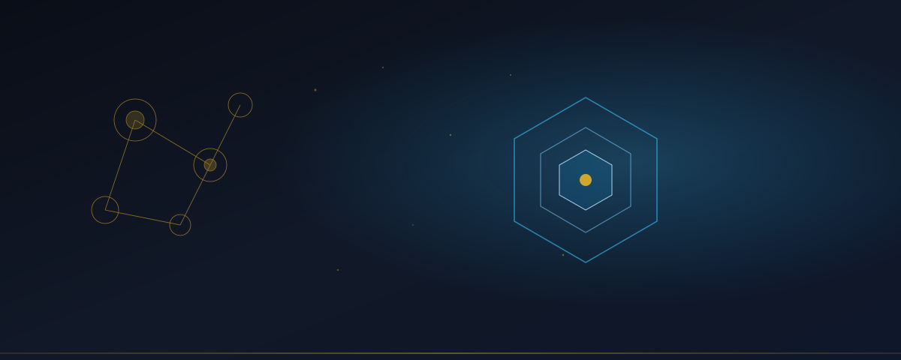

# ABRAXAS

**How representations become causes**

Structure before narrative.  
Evidence before authority.  
Governance before autonomy.

---

## What this is

Abraxas is a system for studying the moment when ideas, models, and representations begin to have real effects in the world.

Most tools generate text or scores. This one asks a different question: which parts of a represented construct have actually become causal, to what degree, through what pathways, and with what evidence?

It is part of Applied Alchemy Labs. Everything runs under strict human oversight. The default mode is careful and advisory. Nothing acts on its own without explicit permission.

---

## The core idea

We treat representations seriously.

A representation is not automatically real. Simulation is not proof. Popularity is not causation. A coherent story is not evidence.

Abraxas keeps hard lines between what was directly observed, what was inferred, what remains speculative, and what cannot yet be measured.

It watches for the recursive process where a representation begins to shape the world in ways that then strengthen the representation itself. That process is studied carefully, never assumed, and never allowed to run without human authority.

---

## How the work proceeds

The system follows a disciplined loop:

1. Define the construct clearly before looking for evidence.
2. Gather evidence with full source history and timing.
3. Model the current state of how much of that construct has become real.
4. Detect anomalies and contamination without jumping to explanations.
5. Make forecasts only from the evidence at hand.
6. Intervene only when explicitly authorized and bounded.
7. Settle the prediction against what actually happened.
8. Update the record without rewriting the past.

Human judgment stays on top of every important decision.

---

## Why the discipline matters

When you study systems that include language, belief, and prediction, the observer can easily become part of the thing being observed. Abraxas records that risk instead of ignoring it.

Success in the field does not automatically become scientific proof. Technical correctness does not equal truth. Economic usefulness does not equal causal validity.

These are kept separate on purpose.

---

## Current posture

This is a candidate system. Production activation is held. The work remains in careful, governed development.

Live proof and runtime landings are in [`scrimshawlife-ctrl/Abraxas`](https://github.com/scrimshawlife-ctrl/Abraxas). This repository remains the doctrine and candidate-architecture home. A landing in the runtime repo is not promotion of this candidate. See [`docs/SIBLING_REPOS.md`](docs/SIBLING_REPOS.md).

Core subsystems include the Belief Graph, Oracle signal layer, governed ingest, pipeline contracts, YGGDRASIL routing, AAL-Viz projection, and operator review surfaces. These run in SHADOW / advisory posture by default: evidence can be prepared for human review, but runtime execution, canon mutation, writeback, and external action stay operator-gated.

Sigil-Forge mounts as an external SHADOW specialist for intent compression (agent-agnostic CLI; genotype + ingest). It is not a live Alembic adapter and does not write the rune catalog. See [`docs/architecture/SIGIL_FORGE_STACK_MOUNT_001.md`](docs/architecture/SIGIL_FORGE_STACK_MOUNT_001.md).

Deeper technical material, architecture notes, status, and research documentation live elsewhere in the repository for those who need them. Agents should start with [`AGENTS.md`](AGENTS.md) and use [`SKILLS.md`](SKILLS.md) only when task-specific skill routing is needed.

---

## License

**Proprietary** — Copyright (c) 2024–2026 Applied Alchemy Labs / Daniel Meyer / Zero State.  
All rights reserved.

---

*Abraxas studies how representations become causes.*
