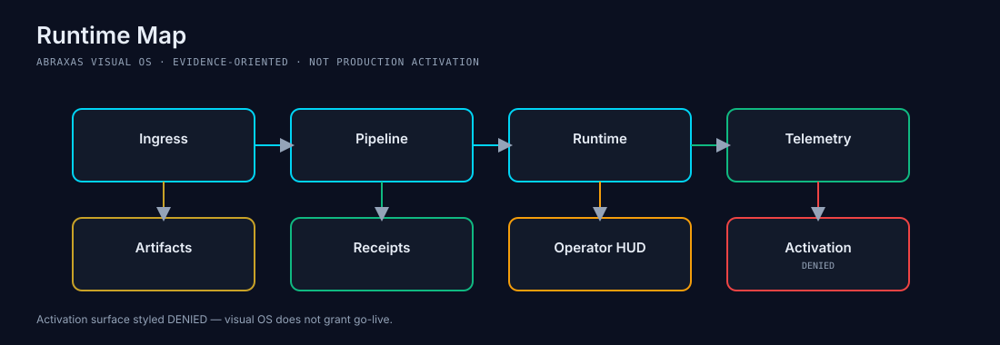

# ABRAXAS

Governed Symbolic Intelligence  
Deterministic • Observable • Recursive


## 01. REPOSITORY SIGNAL SURFACE

Status information generated automatically from repository scans.

| Surface | Value Source | Badge Surface (deployment-dependent) |
|---|---|---|
| Build Status | `docs/status/badges.json#signals.build_status` |  |
| Test Status | `docs/status/badges.json#signals.test_status` |  |
| Coverage Status | `docs/status/badges.json#signals.coverage_status` |  |
| Contract Count | `docs/status/badges.json#signals.contract_count` |  |
| Schema Count | `docs/status/badges.json#signals.schema_count` |  |
| Rune Count | `docs/status/badges.json#signals.rune_count` |  |
| Continuity Lane Count | `docs/status/badges.json#signals.continuity_lane_count` |  |
| Governance Status | `docs/status/badges.json#signals.governance_status` |  |
| Canon Status | `docs/status/badges.json#signals.canon_status` |  |

All repository signal values are generated from local repository scans and should be treated as observational rather than authoritative.

Badge endpoint availability is conditional: treat Pages-backed badges as live only when `ENABLE_STATUS_PAGES_DEPLOY=true` and GitHub Pages is configured for this repository.

## 02. THE MAP



Operator  
↓  
Oracle Signal Layer  
↓  
YGGDRASIL Routing  
↓  
ABX-Runes  
↓  
Governance Layer  
↓  
Temporal Continuity  
↓  
Artifact Generation

## 03. WHAT IS ABRAXAS

Abraxas is a governed symbolic intelligence architecture for deterministic execution. It encodes computation as contract-bound artifacts, route decisions, and replay-safe evidence chains. The repository prioritizes provenance over assertion: every meaningful surface is expected to point back to observable files, schemas, and receipts.

Execution posture is fail-closed. Governance and continuity are advisory-first and evidence-gated, with no implied authority escalation from status pages, projections, or research overlays. YGGDRASIL routing and ABX-Runes define symbolic flow while governance gates constrain promotion behavior. Temporal continuity tracks lane progression as observed repository evidence, not as a claim of external authority.

This is an observational architecture: it surfaces what is present, verifiable, and deterministic in the repo state at scan time.

## 04. SYSTEM ATLAS

| Surface Card | Route |
|---|---|
| Oracle Signal Layer | [`docs/atlas/oracle-signal-layer.md`](docs/atlas/oracle-signal-layer.md) |
| YGGDRASIL Routing | [`docs/atlas/yggdrasil-routing.md`](docs/atlas/yggdrasil-routing.md) |
| ABX-Runes | [`docs/atlas/abx-runes.md`](docs/atlas/abx-runes.md) |
| Governance Engine | [`docs/atlas/governance-engine.md`](docs/atlas/governance-engine.md) |
| Temporal Continuity Spine | [`docs/atlas/temporal-continuity-spine.md`](docs/atlas/temporal-continuity-spine.md) |
| Research Canary | [`docs/atlas/research-canary.md`](docs/atlas/research-canary.md) |
| AAL-Viz | [`docs/atlas/aal-viz.md`](docs/atlas/aal-viz.md) |
| Artifact Registry | [`docs/atlas/artifact-registry.md`](docs/atlas/artifact-registry.md) |

Master atlas: [`docs/atlas/ABRAXAS_ATLAS.md`](docs/atlas/ABRAXAS_ATLAS.md)

## 05. ARCHITECTURE GALLERY

- 
- 
- 
- 
- 
- 

## 06. GOVERNANCE


IDEA  
↓  
SHADOW  
↓  
CANARY  
↓  
PROMOTION  
↓  
CANON

- **SEED:** candidate framing only; no execution authority.
- **ABX-Core:** symbolic runtime constrained by contract gates.
- **Shadow vs Forecast:** shadow is observational execution; forecast authority remains denied unless explicitly promoted.
- **Promotion Gates:** evidence, replay, and governance receipts required before lane transition.
- **Stabilization Windows:** convergence windows gate progression readiness.
- **12-Run Invariance:** maintain deterministic replay consistency across repeated runs.
- **Complexity Rent:** uncontrolled complexity blocks promotion readiness.

## 07. CONTINUITY SPINE

Generated from `docs/status/continuity-spine.json`.

- Observed lane count: `54`
- Highest observed lane: `P102C`
- Lane progression surface: `P0 • P1 • P1A • P1C • P2 • P2A • P2C • P40 • P42 • P43 • P44 • P46 • P47 • P48 • P52 • P58 • P60 • P61 • P63 • P71 • P72 • P73 • P74 • P75 • …`

If continuity data is unavailable: `NOT_COMPUTABLE`.

### Continuity handoff (P102A → P102C)

- P102A source lane: `p101_readiness_repair_plan`
- Run `python scripts/run_temporal_continuity_recursive_authorization_chain_compression_audit.py`
- Expected artifact: `out/temporal_continuity_recursive_authorization_chain_compression_audit/latest.json`
- Governance directives: `SEAL_RECURSIVE_AUTHORIZATION_CHAIN` and `COMPRESS_TO_GENERIC_TEMPLATE`
- Follow-up routes:
  - `python scripts/run_temporal_continuity_repair_execution_plan_router.py`
  - `python scripts/run_temporal_continuity_selected_repair_execution_plan.py`
- `do not add another hand-written recursive authorization lane`

## 08. RESEARCH DOMAINS

- [Symbolic Compression](docs/audits/REPO_AUDIT_CHAMFER_EXPECTED_DISTANCE_POLICY_PLAN_v0_1.md)
- [Temporal Resonance](scripts/run_temporal_resonance_coherence.py)
- [Governance Systems](docs/generated_artifact_policy_v1.md)
- [Coherence Fields](scripts/run_coherence_field_operator_surface.py)
- [Forecast Architecture](scripts/run_forecast_candidates.py)
- [Persistence Geometry](scripts/run_temporal_persistence_memory.py)
- [Topology Research](scripts/run_temporal_topology_cartography.py)
- [Research Canary](docs/atlas/research-canary.md)

## 09. REPOSITORY TOPOLOGY

```text
apps/         read-only API and service entrypoints
core/         deterministic symbolic/gov/runtime logic
contracts/    schemas and contract-bound architecture surfaces
docs/         atlas, audits, plans, visual system, status surfaces
fixtures/     replay fixtures and static verification data
input/        operator-provided runtime inputs and decisions
out/          generated artifacts and governance evidence
scripts/      deterministic generator and replay entrypoints
tests/        replay-stable validation suites
```

Each directory maps to system function: routing and execution (`core/`), governance/evidence (`contracts/`, `out/`), operational orchestration (`scripts/`), and verification (`tests/`).

## 10. ARTIFACT EXAMPLES

Real examples only:

- **Governance Receipt:** `out/audit/governance_freeze_baseline_001.latest.json`
- **Temporal Continuity Artifact:** `out/temporal_continuity_evidence_index/latest.json`
- **Schema Example:** `contracts/runes/catalog.v1.json`
- **Signal Report:** `out/audit/temporal_climate_signal_compression_ledger_contract.latest.json`
- **Route Manifest:** `out/audit/temporal_contract_reconciliation_manifest.latest.json`
- **Rune Binding Artifact:** `NOT_COMPUTABLE` (no explicit rune-binding artifact currently observed under `out/`)

## 11. OPERATOR PATHS

- **NEW OPERATOR:** [`docs/operators/new-operator.md`](docs/operators/new-operator.md)
- **RESEARCHER:** [`docs/operators/researcher.md`](docs/operators/researcher.md)
- **ARCHITECT:** [`docs/operators/architect.md`](docs/operators/architect.md)
- **CONTRIBUTOR:** [`docs/operators/contributor.md`](docs/operators/contributor.md)

## 12. LIVE STATUS

Auto-generated source: `docs/status/badges.json`

- Current Version: `NOT_COMPUTABLE`
- Observed Contracts: `272`
- Observed Schemas: `257`
- Observed Tests: `660`
- Observed Artifacts: `488`
- Observed Runes: `24`
- Observed Continuity Lanes: `54`
- Last Scan Time: `NOT_COMPUTABLE`

If unavailable: `NOT_COMPUTABLE`.

## 13. ROADMAP

Roadmap items are included only where evidence is observable in-repo.

- Route/Rune Binding: `OBSERVED` (`contracts/runes/catalog.v1.json`, `core/yggdrasil_geometric_route_metadata.py`)
- Belief Graph: `NOT_COMPUTABLE`
- Global Ingest: `OBSERVED` (`scripts/run_ingest_once.py`, `scripts/run_oracle_intake.py`)
- Research Shadow Replay: `OBSERVED` (`scripts/run_research_shadow_replay_audit.py`)
- Phase Percolation: `NOT_COMPUTABLE`
- AAL-Viz Projection: `OBSERVED` (`scripts/run_aal_viz_runtime_projection.py`)
- Codegen Intelligence Spine: `NOT_COMPUTABLE`
- Situation Runtime: `OBSERVED` (`scripts/run_operator_runtime_console.py`)

## 14. REPOSITORY STATUS API

Generated observational surfaces:
- `docs/status/badges.json`
- `docs/status/continuity-spine.json`
- `docs/status/badges/*.json`

These are observational repository surfaces.
They do not grant authority.
They do not promote canon.
They do not alter runtime behavior.

## 15. SHIELDS / GITHUB PAGES

After the first successful GitHub Pages deployment of status surfaces (with `ENABLE_STATUS_PAGES_DEPLOY=true` and GitHub Pages configured), the following endpoints are expected:

- `https://scrimshawlife-ctrl.github.io/Abraxas-v2.0/badges.json`
- `https://scrimshawlife-ctrl.github.io/Abraxas-v2.0/badges/contracts.json`
- `https://scrimshawlife-ctrl.github.io/Abraxas-v2.0/badges/schemas.json`
- `https://scrimshawlife-ctrl.github.io/Abraxas-v2.0/badges/tests.json`
- `https://scrimshawlife-ctrl.github.io/Abraxas-v2.0/badges/continuity.json`

Availability should be treated as deployment-dependent until Pages has completed successfully.

## 16. REPO ↔ NOTION RECONCILIATION STATUS

Purpose: track alignment between Canon Architecture, Repo Reality, and the active continuity lane.

- Latest Artifact: `NOT_COMPUTABLE`
- Status: `NOT_COMPUTABLE`

Allowed status vocabulary:
- `SYNCED`
- `PARTIAL`
- `DRIFT_DETECTED`
- `NOT_COMPUTABLE`

## 17. FOOTER

**ABRAXAS**  
A governed symbolic intelligence architecture.  
Built within the Applied Alchemy Labs ecosystem.  
Structure before narrative.  
Evidence before authority.  
Governance before autonomy.
