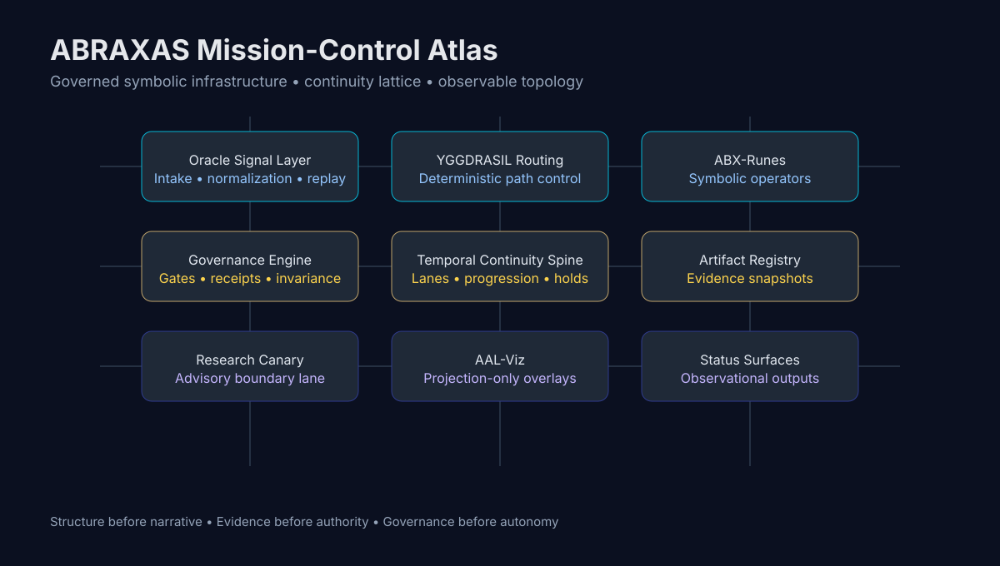

# ABRAXAS

Governed Symbolic Intelligence  
Deterministic • Observable • Recursive



---

## 01. ARCHITECTURE

Abraxas is a governed symbolic intelligence architecture for deterministic execution. It encodes computation as contract-bound artifacts, route decisions, and replay-safe evidence chains. Every meaningful surface points back to observable files, schemas, and receipts.

**Execution posture:** fail-closed.  
**Governance posture:** advisory-first, evidence-gated.  
**Routing posture:** deterministic, replayable, formalized advisory surface.

No implied authority escalation from status pages, projections, or research overlays.

```
Operator
  ↓
Oracle Signal Layer      — intake, normalization, replay-safe signal attachment
  ↓
YGGDRASIL Routing        — deterministic symbolic path control
  ↓
ABX-Runes                — contract-bound symbolic operators (24 observed)
  ↓
Governance Engine        — promotion gates, receipts, stabilization windows
  ↓
Temporal Continuity      — lane evidence, progression tracking, holds
  ↓
Artifact Registry        — deterministic evidence snapshots
```

Evidence paths:
- `contracts/runes/catalog.v1.json` — rune catalog
- `contracts/yggdrasil/routes/*.route.v1.json` — route graphs
- `contracts/pipelines/*.v1_1.json` — pipeline contracts
- `core/yggdrasil_geometric_route_metadata.py` — route metadata
- `out/audit/yggdrasil_rune_route_binding_matrix_001.latest.json` — formalized advisory binding surface

---

## 02. GOVERNANCE


```
SEED → SHADOW → CANARY → PROMOTION → CANON
```

- **SEED:** candidate framing only; no execution authority.
- **ABX-Core:** symbolic runtime constrained by contract gates.
- **Shadow vs Forecast:** shadow is observational execution; forecast authority remains denied unless explicitly promoted.
- **Promotion Gates:** evidence, replay, and governance receipts required before lane transition.
- **Stabilization Windows:** convergence windows gate progression readiness.
- **12-Run Invariance:** maintain deterministic replay consistency across repeated runs.
- **Complexity Rent:** uncontrolled complexity blocks promotion readiness.

Governance evidence: `out/audit/governance_freeze_baseline_001.latest.json`  
Governance status (observed): `FROZEN` (source: `docs/status/badges.json#signals.governance_status`)  
Canon status (observed): `ADVISORY_ONLY` (source: `docs/status/badges.json#signals.canon_status`)

---

## 03. CONTINUITY SPINE

Source: `docs/status/continuity-spine.json`  
Schema: `continuity_spine_surface.v1`

| Signal | Value |
|---|---|
| Observed lane count | `54` |
| Highest observed lane | `P102C` |
| Source | `docs/status/continuity-spine.json` |

Lane progression (observed):
```
P0 • P1 • P1A • P1C • P2 • P2A • P2C • P40 • P42 • P43 • P44 • P46 • P47 •
P48 • P52 • P58 • P60 • P61 • P63 • P71 • P72 • P73 • P74 • P75 • P76 • P77 •
P78 • P79 • P80 • P81 • P82 • P83 • P84 • P85 • P86 • P87 • P88 • P89 • P90 •
P91 • P92 • P93 • P94 • P95 • P96 • P97 • P98 • P99 • P100 • P101 • P102 •
P102A • P102B • P102C
```

If continuity data is unavailable: `NOT_COMPUTABLE`.

Active handoff (P102A → P102C):
- Source lane: `p101_readiness_repair_plan`
- Governance directives: `SEAL_RECURSIVE_AUTHORIZATION_CHAIN`, `COMPRESS_TO_GENERIC_TEMPLATE`
- Follow-up routes: `run_temporal_continuity_repair_execution_plan_router.py`, `run_temporal_continuity_selected_repair_execution_plan.py`

---

## 04. EVIDENCE SURFACES

Generated observational surfaces — these are read-only, advisory-only outputs:

| Surface | Path | Status |
|---|---|---|
| Repository signal badges | `docs/status/badges.json` | OBSERVED |
| Continuity spine | `docs/status/continuity-spine.json` | OBSERVED |
| Repo ↔ Notion reconciliation | `docs/audits/ABRAXAS_REPO_NOTION_DIFF_001.md` | OBSERVED |
| Binding matrix audit | `docs/audits/ABRAXAS_BINDING_MATRIX_AND_COUPLING_MAP_AUDIT_001.md` | OBSERVED |
| Rune/route binding matrix | `out/audit/yggdrasil_rune_route_binding_matrix_001.latest.json` | OBSERVED |
| Coupling map | `out/audit/yggdrasil_coupling_map_001.latest.json` | OBSERVED |
| Governance receipt | `out/audit/governance_freeze_baseline_001.latest.json` | OBSERVED |
| Temporal continuity artifact | `out/temporal_continuity_evidence_index/latest.json` | OBSERVED |

These surfaces do not grant authority, do not promote canon, and do not alter runtime behavior.

---

## 05. ROUTING AND RUNE BINDING

Route/rune binding is now a formalized advisory surface sourced from repository contracts.

**Binding matrix summary** (source: `out/audit/yggdrasil_rune_route_binding_matrix_001.latest.json`):
- Total runes in catalog: `24`
- Bound runes (present in at least one pipeline): `20`
- Unbound runes: `4` (`RUNE.PIPELINE.OPERATOR_REVIEW`, `RUNE.PIPELINE.STABILIZATION_DECIDE`, `RUNE.YGGDRASIL.ROUTE_RECEIPT`, `RUNE.YGGDRASIL.UNKNOWN_NODE_GATE`)
- Pipelines: `7`
- Route-reachable pipelines: `7`
- Required mapping rows: `89`
- Binding classification: `PARTIAL` (route rune nodes observed without explicit `rune_id` field linkage)
- Advisory status: `BINDING_SURFACE_FORMALIZED_ADVISORY_ONLY`

**Coupling map** (source: `out/audit/yggdrasil_coupling_map_001.latest.json`):
- Derived from: pipeline contracts + route graphs
- Authority locks: all `false` (deny-by-default across all rune/pipeline/route surfaces)

This surface is advisory-only. It describes observed binding topology; it does not grant routing authority.

---

## 06. REPOSITORY SIGNAL SURFACE

Status values generated automatically from repository scans. Badge endpoint availability is conditional: treat Pages-backed badges as live only when `ENABLE_STATUS_PAGES_DEPLOY=true` and GitHub Pages is configured.

| Signal | Observed Value | Source | Badge (deployment-dependent) |
|---|---|---|---|
| Build Status | `NOT_COMPUTABLE` | `badges.json#signals.build_status` |  |
| Test Status | `NOT_COMPUTABLE` | `badges.json#signals.test_status` |  |
| Coverage Status | `NOT_COMPUTABLE` | `badges.json#signals.coverage_status` |  |
| Contracts | `272` | `badges.json#signals.contract_count` |  |
| Schemas | `257` | `badges.json#signals.schema_count` |  |
| Runes | `24` | `badges.json#signals.rune_count` |  |
| Continuity Lanes | `54` | `badges.json#signals.continuity_lane_count` |  |
| Governance Status | `FROZEN` | `badges.json#signals.governance_status` |  |
| Canon Status | `ADVISORY_ONLY` | `badges.json#signals.canon_status` |  |

Extended observed counts (source: `docs/status/badges.json#live_status`):
- Observed Tests: `660`
- Observed Artifacts: `488`
- Last Observed Commit: `2026-06-02T00:34:53Z`
- Last Scan Time: `NOT_COMPUTABLE`

---

## 07. SYSTEM ATLAS

Master atlas: [`docs/atlas/ABRAXAS_ATLAS.md`](docs/atlas/ABRAXAS_ATLAS.md)

| Surface | Atlas Card | Status |
|---|---|---|
| Oracle Signal Layer | [`docs/atlas/oracle-signal-layer.md`](docs/atlas/oracle-signal-layer.md) | OBSERVED |
| YGGDRASIL Routing | [`docs/atlas/yggdrasil-routing.md`](docs/atlas/yggdrasil-routing.md) | OBSERVED |
| ABX-Runes | [`docs/atlas/abx-runes.md`](docs/atlas/abx-runes.md) | OBSERVED |
| Governance Engine | [`docs/atlas/governance-engine.md`](docs/atlas/governance-engine.md) | OBSERVED |
| Temporal Continuity Spine | [`docs/atlas/temporal-continuity-spine.md`](docs/atlas/temporal-continuity-spine.md) | OBSERVED |
| Research Canary | [`docs/atlas/research-canary.md`](docs/atlas/research-canary.md) | OBSERVED |
| AAL-Viz | [`docs/atlas/aal-viz.md`](docs/atlas/aal-viz.md) | OBSERVED |
| Artifact Registry | [`docs/atlas/artifact-registry.md`](docs/atlas/artifact-registry.md) | OBSERVED |

---

## 08. ARCHITECTURE DIAGRAMS

- 
- 
- 
- 
- 
- 

Visual system specification: [`docs/media/README_VISUAL_SYSTEM.md`](docs/media/README_VISUAL_SYSTEM.md)

---

## 09. REPOSITORY TOPOLOGY

```text
apps/         read-only API and service entrypoints
core/         deterministic symbolic/gov/runtime logic
contracts/    schemas and contract-bound architecture surfaces
docs/         atlas, audits, plans, visual system, status surfaces
fixtures/     replay fixtures and static verification data
input/        operator-provided runtime inputs and decisions
out/          generated artifacts and governance evidence
scripts/      deterministic generator and replay entrypoints
tests/        replay-stable validation suites
```

---

## 10. REPO ↔ NOTION RECONCILIATION

Source: `docs/audits/ABRAXAS_REPO_NOTION_DIFF_001.md`

| Surface | Status | Evidence |
|---|---|---|
| YGGDRASIL ABX-Runes Full Stack Binding | PARTIAL | binding matrix emitted; route rune_id linkage partial |
| Tier-1 Subsystem Registry | OBSERVED | `core/pipelines/registry.py` |
| Runtime Integration Gate | PARTIAL | runtime spine skeleton present |
| Global Ingest Adapter Spine | PARTIAL | entrypoints observed; no adapter spine contract |
| Belief Graph Engine | MISSING | `NOT_COMPUTABLE` — no module/contract/runner |
| Research Shadow Replay Engine | OBSERVED | `core/research_shadow_replay_audit.py` |
| Phase Percolation Engine | PARTIAL | partial temporal surfaces only |
| AAL-Viz Projection Spine | OBSERVED | `core/aal_viz_runtime_projection.py` |
| Situation Runtime Engine | PARTIAL | advisory console observed |
| ABX Codegen Intelligence Spine | MISSING | `NOT_COMPUTABLE` — no modules/contracts |

Overall reconciliation status: `PARTIAL`

---

## 11. ROADMAP

Roadmap items included only where evidence is observable in-repo.

| Item | Status | Evidence |
|---|---|---|
| Route/Rune Binding | `FORMALIZED_ADVISORY` | `out/audit/yggdrasil_rune_route_binding_matrix_001.latest.json` |
| Belief Graph | `NOT_COMPUTABLE` | no implementation surface found |
| Global Ingest | `PARTIAL` | `scripts/run_ingest_once.py`, `scripts/run_oracle_intake.py` |
| Research Shadow Replay | `OBSERVED` | `scripts/run_research_shadow_replay_audit.py` |
| Phase Percolation | `NOT_COMPUTABLE` | partial only |
| AAL-Viz Projection | `OBSERVED` | `scripts/run_aal_viz_runtime_projection.py` |
| Codegen Intelligence Spine | `NOT_COMPUTABLE` | no implementation surface found |
| Situation Runtime | `OBSERVED` | `scripts/run_operator_runtime_console.py` |

---

## 12. OPERATOR PATHS

- **NEW OPERATOR:** [`docs/operators/new-operator.md`](docs/operators/new-operator.md)
- **RESEARCHER:** [`docs/operators/researcher.md`](docs/operators/researcher.md)
- **ARCHITECT:** [`docs/operators/architect.md`](docs/operators/architect.md)
- **CONTRIBUTOR:** [`docs/operators/contributor.md`](docs/operators/contributor.md)

---

## 13. RESEARCH DOMAINS

- [Symbolic Compression](docs/audits/REPO_AUDIT_CHAMFER_EXPECTED_DISTANCE_POLICY_PLAN_v0_1.md)
- [Temporal Resonance](scripts/run_temporal_resonance_coherence.py)
- [Governance Systems](docs/generated_artifact_policy_v1.md)
- [Coherence Fields](scripts/run_coherence_field_operator_surface.py)
- [Forecast Architecture](scripts/run_forecast_candidates.py)
- [Persistence Geometry](scripts/run_temporal_persistence_memory.py)
- [Topology Research](scripts/run_temporal_topology_cartography.py)
- [Research Canary](docs/atlas/research-canary.md)

---

## 14. SHIELDS / GITHUB PAGES

Badge endpoints are available after a successful GitHub Pages deployment (`ENABLE_STATUS_PAGES_DEPLOY=true`, Pages configured).

Treat all endpoints as deployment-dependent until Pages has completed successfully:

- `https://scrimshawlife-ctrl.github.io/Abraxas-v2.0/badges.json`
- `https://scrimshawlife-ctrl.github.io/Abraxas-v2.0/badges/contracts.json`
- `https://scrimshawlife-ctrl.github.io/Abraxas-v2.0/badges/schemas.json`
- `https://scrimshawlife-ctrl.github.io/Abraxas-v2.0/badges/tests.json`
- `https://scrimshawlife-ctrl.github.io/Abraxas-v2.0/badges/continuity.json`
- `https://scrimshawlife-ctrl.github.io/Abraxas-v2.0/badges/governance.json`

---

## 15. FOOTER

```
README_STATUS_SURFACE_UPDATED=true
CANON_MUTATION=false
RUNTIME_MUTATION=false
FORECAST_ROUTING=false
EXECUTION_AUTHORITY=false
```

**ABRAXAS**  
A governed symbolic intelligence architecture.  
Built within the Applied Alchemy Labs ecosystem.  
Structure before narrative.  
Evidence before authority.  
Governance before autonomy.
