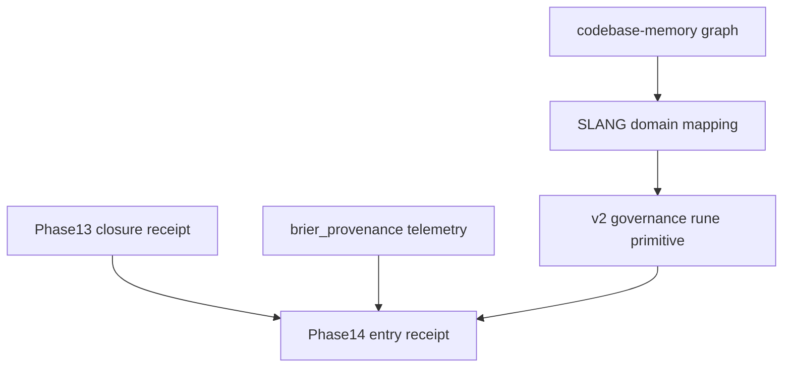

# Phase 14 — SLANG Memetic Rune Activation (Planning Stub)

## Provenance header

| Field | Value |
|---|---|
| `classification` | `SPECULATIVE` |
| `phase` | `14` |
| `operator_review_posture` | `ACTIVE` |
| `authority_state` | `read/controlled-write` |
| `downstream` | `NOT_COMPUTABLE` |
| `upstream_closure` | `v2_hygiene_phase13_operator_intelligence_closure_receipt_001` |

## Objectives (high-level)

1. **Abraxas-SLANG-EMULATION graph integration** — bind slang domain tags from `abx-afe/afe/real_world_mapping.py` into codebase-memory graph compression surfaces.
2. **Rune activation scaffolding** — extend `v2_governance_rune_primitive` toward governed activation without catalog mutation until operator registration gate.
3. **Brier scoring live hooks** — wire telemetry hooks from `core/governance/brier_provenance.py` into hygiene lanes; resolution remains denied.
4. **Governance surface expansion** — promote hyperstition anchor primitives and symbolic route atlas skills under operator review.

## Initial deliverables skeleton

```json
{
  "phase": 14,
  "deliverables": [
    {
      "id": "SLANG-GRAPH-BIND",
      "classification": "SPECULATIVE",
      "depends_on": [".codebase-memory/graph.db.zst", "docs/skills/symbolic-route-atlas.md"]
    },
    {
      "id": "RUNE-ACTIVATION-GATE",
      "classification": "SPECULATIVE",
      "depends_on": ["contracts/governance/v2_governance_rune_primitive.v1.schema.json"]
    },
    {
      "id": "BRIER-LIVE-HOOKS",
      "classification": "SPECULATIVE",
      "depends_on": ["core/governance/brier_provenance.py", "core/scoring/brier.py"]
    },
    {
      "id": "PHASE14-ENTRY-RECEIPT",
      "classification": "SPECULATIVE",
      "depends_on": ["v2_hygiene_phase13_operator_intelligence_closure_receipt_001"]
    }
  ],
  "authority_denials": {
    "rune_registration_authorized": false,
    "brier_resolution_authorized": false,
    "notion_writeback_allowed": false,
    "execution_authority": false
  }
}
```

## Dependency graph



## Denials

- No rune catalog mutation in Phase 14 planning
- No Brier outcome resolution
- No Notion auto-writeback
- No continuity P-lane expansion without separate governed audit
