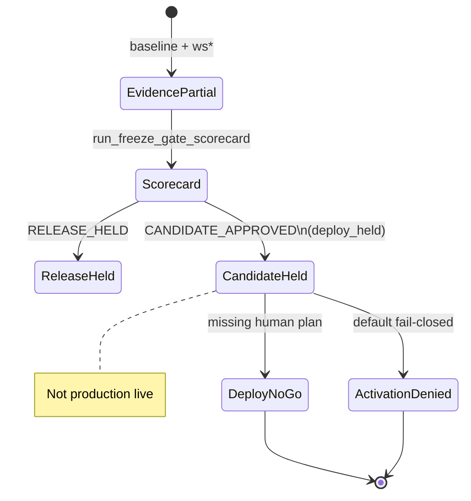

# Abraxas Production Readiness — Engineering Guidebook

```yaml
document: PRODUCTION_READINESS_ENGINEERING_GUIDEBOOK
version: 1.0.0
aligned_to: CONTINUATION_PLAN.v11
evidence_package: out/production_readiness/
posture: CANDIDATE_HELD_FOR_OPERATOR_DEPLOY
production_activation_authorized: false
baseline_evidence_state: Partial
```

**Audience:** operators, maintainers, coding agents.  
**Authority:** advisory documentation; binding facts are JSON receipts under `out/production_readiness/`.

---

## 1. Purpose and non-goals

### Purpose

Provide a multi-angle engineering guide for the **bounded production-candidate** track:

- Technical: generators, registries, SUPPORTED surfaces, CI  
- Governance: stability classes, fail-closed authority, operator decisions  
- Operational: runbooks, deploy readiness, recovery  
- Strategic: what “candidate” means vs production go-live  

### Non-goals

- Declaring Abraxas **production ready**  
- Auto-deploy or auto-activation  
- Replacing root [`README.md`](../../README.md) identity docs  
- Claiming sandbox-only WS0–WS10 simulation as live Verified truth without receipts  

---

## 2. Evidence discipline

### Evidence states

| State | Use when |
|-------|----------|
| `Missing` | Required artifact absent |
| `Partial` | Package present; DoD incomplete |
| `Verified` | Durable proof + DoD met (rare; do not stretch) |
| `NOT_COMPUTABLE` | Cannot be known in this environment (with reason) |

### Provenance fields (canonical JSON)

Typical fields on readiness artifacts:

- `schema_version` / `artifact_type`  
- `produced_at` (UTC `Z`)  
- `producer` (script/module id)  
- `repository_sha`  
- `evidence_state`  
- `work_package` when applicable  

Writers: `core.canonical.json.write_canonical_json` via sole-writer `scripts/run_*`.

### Overclaim checklist (reject if true)

- [ ] Baseline labeled Verified without full exit criteria  
- [ ] “Production ready” without activation gate AUTHORIZED  
- [ ] Fail-closed sole-writer while residual findings high  
- [ ] Notion Verified without durable Evidence/PR links  

---

## 3. System architecture (readiness track)

### 3.1 Components

| Component | Location | Role |
|-----------|----------|------|
| Generators | `core/production_readiness/*.py` | Pure-ish builders of receipts |
| Runners | `scripts/run_*.py` | Sole writers to `out/` |
| Contracts | `contracts/production_readiness/`, `contracts/services/` | Schemas |
| Evidence | `out/production_readiness/` | Canonical package |
| Tests | `tests/test_*readiness*`, service tests | Contract/regression |
| CI | `scripts/run_fast_ci.py` + `.github/workflows` | Validation + advisory gates |

### 3.2 Mermaid — decision stack



### 3.3 Stability classes

| Class | CI posture | Consumer contract |
|-------|------------|-------------------|
| SUPPORTED | Must not break without major version discipline | Dependable |
| ADVISORY | Often report-only | May change |
| INTERNAL | Hidden | No external API |
| EXPERIMENTAL | Incomplete | Candidates only |

Registry: `out/production_readiness/ws1/interface_registry_snapshot.v1.json`  
Services: `out/production_readiness/ws3/service_registry.v1.json`

---

## 4. Workstreams landed (repo fact)

| Dir | Workstream theme | Status lens |
|-----|------------------|-------------|
| `baseline/` | Inventories, blockers, validation attach | COMPLETE package / **Partial** evidence |
| `ws1/` | Interface registry, sole-writer, residual accept | SUPPORTED set advancing |
| `ws2/` | Writer debt, WP-D pure builders, D4 inventory, boundary design | MITIGATING residual |
| `ws3/` | Service registry | 2 SUPPORTED services |
| `ws5/` | Neon Genie allowlist | Non-control-plane |
| `ws6/` | Soft CI audit + disposition | Soft gates kept soft |
| `ws8/` | Threat, Notion, freeze, release, deploy, auth, runbook | Candidate held |

### 4.1 WP-D consolidations (technical)

Batches 1–3 moved disk writes out of selected `core/*/runtime.py` modules into `scripts/run_*` publishers. Receipt: `ws2/wp_d_consolidation_receipt.v1.json`.

**Trade-off:** Residual CORE_BUILDER_OR_HELPER findings remain; fail-closed sole-writer is intentionally **not** enabled.

### 4.2 D4 prep (strategic backlog)

Inventory only: `ws2/sole_writer_d4_target_inventory.v1.json`

| Cluster | Priority | Example |
|---------|----------|---------|
| D4-C1 | P1 | `manual_execution*` runtimes |
| D4-C2 | P1 | `core/ingest` scheduler |
| D4-C3 | P2 | observability / proposal sandbox |
| D4-C4 | P2 | skills writers |
| D4-C5 | P3 | abx-afe |

---

## 5. Freeze gates (G1–G8)

Producer: `scripts/readiness/run_freeze_gate_scorecard.py` → `ws8/freeze_gate_scorecard.v1.json`

| Gate | Criterion |
|------|-----------|
| G1 | Live CI green on pinned SHA (baseline validation) |
| G2 | Threat model operator-reviewed |
| G3 | SUPPORTED set ≥3 preferred |
| G4 | Sole-writer residual accepted / under threshold |
| G5 | Neon allowlist + check |
| G6 | ≥1 SUPPORTED service |
| G7 | Release decision artifact present |
| G8 | No unmitigated OPEN P0 |

**Implication:** `recommended_release_code` may be `CANDIDATE_APPROVED` when all pass; **binding** code is `release_decision.v1.json`.

---

## 6. Governance surfaces

### 6.1 Release decision

```bash
python scripts/readiness/run_release_decision.py \
  --decision-code CANDIDATE_APPROVED \
  --operator "…" \
  --notes "…"
```

Allowed codes: `RELEASE_HELD` | `OPERATOR_REVIEW_REQUIRED` | `NOT_COMPUTABLE` | `CANDIDATE_APPROVED`

Guard: `CANDIDATE_APPROVED` auto-downgrades to `RELEASE_HELD` if scorecard not `all_pass`.

Semantics of `CANDIDATE_APPROVED`:

| Field | Value |
|-------|--------|
| `deploy_held` | true |
| `production_activation_authorized` | false |
| `readiness_state` | `CANDIDATE_HELD_FOR_OPERATOR_DEPLOY` |

### 6.2 Production activation authority (fail-closed)

Producer: `scripts/readiness/run_production_activation_authority_gate.py`  
Artifact: `ws8/production_activation_authority_gate.v1.json`

- Default **`DENIED`**  
- Token path `input/production_activation/production_activation_authority.v1.json` is **not auto-honored**  
- Separate future WP + dual control required for any AUTHORIZED state  

### 6.3 Deploy readiness

Producer: `scripts/readiness/run_candidate_deploy_readiness.py`  
Default **`NO_GO`** until human deploy plan, env attestation, and deploy unhold exist.

### 6.4 Threat model

- `threat_model.v0.json` — Partial  
- Operator decision: `ACCEPT_PARTIAL_BASELINE`  
- Not pen-test Verified  

### 6.5 Notion

- Mapping: `ws8/notion_readiness_mapping.v1.json`  
- Writeback receipt: `ws8/notion_writeback_receipt.v1.json`  
- Hub/tracker links exist; Evidence State remains **Partial** unless operator Verifies DoD  

---

## 7. Operational procedures

### 7.1 Daily / PR validation

```bash
export PATH="$(pwd)/.venv/bin:$PATH"
python scripts/run_fast_ci.py
```

Advisory (fail-open inside fast CI):

- boundary advisory  
- sole-writer advisory  
- neon allowlist check  

### 7.2 Re-pin pattern

1. Emit generators  
2. Commit  
3. Re-emit with new SHA  
4. **Preserve** live validation (`--validation-json` or `--with-fast-ci`)  
5. Commit re-pin  

### 7.3 Recovery drill

```bash
python scripts/readiness/run_recovery_drill_v0.py
```

Dry-run: critical paths must be git-tracked and `git show HEAD:path` ok. No worktree mutation.

### 7.4 SUPPORTED service examples

**Validation service** — contracts/-only `schema_ref`; machine-readable errors.

**Artifact provenance service** — hash/dumps/write; path policy `out/` only (no traversal). CLI lives under `scripts/artifact/` for organization CI.

---

## 8. CI / CD notes

| Surface | Behavior |
|---------|----------|
| `run_fast_ci` | SUPPORTED validation entry; drift protection |
| Soft gates | Historical `continue-on-error` inventoried; disposition keep soft |
| Script organization | New `run_artifact_*` scripts belong under `scripts/artifact/` |
| Boundary fail-closed | Design exists; env default **off** |

Trade-off: soft gates reduce flakiness but can mask quality issues — tracked in `ws6/soft_ci_gate_disposition.v1.json`.

---

## 9. Edge cases and implications

| Edge case | Implication |
|-----------|-------------|
| Scorecard all_pass but RELEASE_HELD | Operator may hold candidate intentionally |
| Re-pin wipes live CI attach | G1 drops to PARTIAL; scorecard eligibility may degrade |
| Residual sole-writer accepted | Gate G4 passes; **not** permission to fail-close |
| Notion writeback without Verified | RISK-012 stays MITIGATING |
| Agent tries activation | Gate remains DENIED; denied_actions listed |

---

## 10. Troubleshooting matrix

| Issue | Mitigation |
|-------|------------|
| pytest can't find venv python | Absolute PATH to `.venv/bin` |
| Organization check fails | Relocate matching `PREFIX_MAP` scripts |
| Dirty worktree fails CI | Commit or restore generated drift |
| JSON not staged | `git add -f out/production_readiness/...` |
| Docs links break | `python scripts/readiness/run_production_readiness_docs_crosslink_check.py` |

---

## 11. Roadmap (honest)

| Horizon | Item | Blocker |
|---------|------|---------|
| Near | Optional D4-C1 pure-builder PR | Engineering capacity |
| Near | Human deploy plan if trial deploy desired | Operator |
| Mid | Notion Verified DoD per checkpoint | Operator review |
| Far | Production activation AUTHORIZED | Dual control + threat Verified + unhold |
| Avoid | Marketing “production ready” | Activation DENIED |

---

## 12. Validation checklist (docs + code)

- [ ] `out/production_readiness/README.md` present  
- [ ] Active plan is CONTINUATION_PLAN.v11 (or superseding)  
- [ ] Release decision matches intended code  
- [ ] Activation gate `DENIED`  
- [ ] Deploy readiness `NO_GO` unless human artifacts exist  
- [ ] Scorecard regenerates cleanly  
- [ ] Docs crosslink check exit 0  
- [ ] Recovery drill includes critical decision artifacts  

```bash
export PATH="$(pwd)/.venv/bin:$PATH"
python scripts/readiness/run_production_readiness_docs_crosslink_check.py
python scripts/readiness/run_freeze_gate_scorecard.py
python scripts/readiness/run_production_activation_authority_gate.py
python scripts/readiness/run_candidate_deploy_readiness.py
python scripts/readiness/run_recovery_drill_v0.py
```

---

## 13. Glossary

| Term | Definition |
|------|------------|
| Sole-writer | Only designated runners write canonical evidence under `out/` |
| Freeze | Scorecard evaluation of candidate eligibility |
| Deploy held | Candidate may be declared; ship not authorized |
| Activation | Production go-live authority (separate from candidate) |
| Partial | Incomplete DoD; package may still be COMPLETE |

---

## 14. Document control

| Field | Value |
|-------|--------|
| Supersedes | Informal readiness notes / sandbox-only guide copies |
| Canonical package | `out/production_readiness/` |
| Related PR | https://github.com/scrimshawlife-ctrl/Abraxas-v2.0/pull/971 |

*End of guidebook. Prefer JSON receipts over narrative when conflicts arise.*
