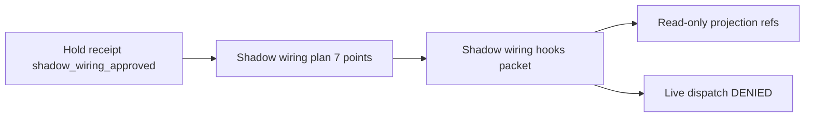

# Post–Merge #724 Extensive Continuation Plan

Comprehensive advisory program routing after PR #724 landed on `main` (2026-06-18). Expands the brief [`POST_MERGE_723_CONTINUATION_PLAN.md`](POST_MERGE_723_CONTINUATION_PLAN.md) into an operator- and agent-actionable specification.

---

## Section A — Program state and baseline

### Completed chain (#719–#724)

| PR | Lane | Deliverable |
|----|------|-------------|
| #719 | Operator hold clearance | Daniel Meyer payloads, per-domain intake chains |
| #720 | Audit sync | `POST_2_5_0_CONTINUATION_AUDIT`, PLANS/STATUS, bulk disposition |
| #721 | Oracle shadow physical implementation | `core/oracle_signal.py` auth-record-bound shadow processing |
| #722 | Runtime shadow wiring plan | 7 integration points, plan artifacts |
| #723 | Continuation plan + doc sync | `POST_MERGE_720_722_CONTINUATION_PLAN` |
| #724 | Brief continuation plan | `POST_MERGE_723_CONTINUATION_PLAN` |

### Governance posture matrix

| Surface | Value | Source |
|---------|-------|--------|
| Continuation frontier | `NOT_COMPUTABLE` | `out/audit/continuation_frontier_reconciliation_001.latest.json` |
| Bulk disposition | `authority_grant_count=0` | `out/operator_review/operator_review_required_items_bulk_disposition_001.latest.json` |
| Canary guardrail | active (no regen) | continuation frontier + AGENTS.md |
| Runtime hold | `shadow_wiring_approved=true` | hold receipt |
| Pre-dispatch wiring | `mandatory_pre_dispatch_wiring=false` | hold receipt |
| Shadow wiring plan | `RUNTIME_INTEGRATION_GATE_SHADOW_WIRING_PLAN_READY` | plan artifact |
| Oracle gap backlog | `AUTHORIZED_ADVISORY_SHADOW` (P0) | gap backlog |
| P131 activation | all DROP candidates held | operator decision record |

### Validation baseline (copy-paste)

```bash
python scripts/readiness/run_canon_resume_state.py
python scripts/readiness/run_continuation_frontier_reconciliation.py
python Scripts/run_global_pipeline_gap_backlog.py
python scripts/runtime/run_runtime_integration_gate_shadow_wiring_plan.py
python scripts/run_fast_ci.py
```

Expected: all pass; `recommended_next_lane=NOT_COMPUTABLE`; `authority_grant_count=0`.

---

## Section B — PR #726: Shadow wiring hooks (primary implementation lane) — **COMPLETE (merged 2026-06-18)**

**Branch:** `cursor/runtime-shadow-wiring-impl-1234`

**Reference pattern:** [`core/oracle_signal.py`](../core/oracle_signal.py) — consume upstream artifacts, branch status on eligibility, hardcode authority locks, canonical hash.

### Module design

**New file:** `core/runtime_integration_gate_shadow_wiring_hooks.py`

| Function | Responsibility |
|----------|----------------|
| `_read_json` | Shared JSON loader (match plan module) |
| `_authority_locks()` | All false; mirror oracle `_authority_locks()` |
| `_load_plan` / `_load_hold_receipt` | Read plan + hold receipt from paths in [`runtime_integration_gate_shadow_wiring_plan.py`](../core/runtime_integration_gate_shadow_wiring_plan.py) |
| `shadow_wiring_hooks_eligible(source_root)` | True when plan `READY` + hold `shadow_wiring_approved` + `valid_for_runtime_wiring` |
| `_projection_binding_ref(integration_point_id)` | Deterministic read-only path string from point ID |
| `_build_binding(point)` | Per point: id, target surface, owner, projection ref, wiring mode |
| `build_runtime_integration_gate_shadow_wiring_hooks_packet` | Full packet builder |
| `write_runtime_integration_gate_shadow_wiring_hooks` | Write JSON + `.md` summary |

### Packet shape (deterministic)

```json
{
  "schema_version": "RuntimeIntegrationGateShadowWiringHooks.v1",
  "hooks_id": "runtime_integration_gate_shadow_wiring_hooks_001",
  "status": "RUNTIME_INTEGRATION_GATE_SHADOW_WIRING_HOOKS_EMITTED",
  "advisory_only": true,
  "projection_only": true,
  "non_authoritative": true,
  "shadow_wiring_approved": true,
  "mandatory_pre_dispatch_wiring": false,
  "execution_authority": false,
  "runtime_mutation_allowed": false,
  "integration_point_binding_count": 7,
  "integration_point_bindings": [],
  "source_plan_path": "out/audit/runtime_integration_gate_shadow_wiring_plan_001.latest.json",
  "source_plan_hash": "<from plan>",
  "source_hold_receipt_path": "out/audit/runtime_integration_gate_operator_review_decision_record_hold_receipt_001.latest.json",
  "source_hold_receipt_hash": "<from hold>",
  "authority_locks": {
    "canon_mutation": false,
    "execution_authority": false,
    "ingest_runner_mutation": false,
    "queue_mutation": false,
    "runtime_mutation": false,
    "scheduler_mutation": false
  },
  "recommended_next_lane": "NOT_COMPUTABLE",
  "hooks_hash": "<canonical hash>"
}
```

Status when blocked: `RUNTIME_INTEGRATION_GATE_SHADOW_WIRING_HOOKS_BLOCKED`.

### Per-integration-point binding table

Binding refs are **declarative read-only pointers** in the hooks packet. No file creation or live runtime wiring in this PR — stable path strings derived deterministically from `integration_point_id`.

| integration_point_id | source_canonical_owner | target_runtime_surface | projection_binding_ref |
|---------------------|------------------------|------------------------|------------------------|
| AAL_VIZ_PROJECTION_SPINE_001 | AAL-Viz Projection Spine | packet-derived projection and visualization outputs | `out/projection/aal_viz_projection_spine_shadow_binding_001.latest.json` |
| ABX_CODEGEN_INTELLIGENCE_SPINE_001 | ABX Codegen Intelligence Spine | governed code-drop and patch-contract planning handoff | `out/audit/abx_codegen_intelligence_spine_shadow_binding_001.latest.json` |
| BELIEF_GRAPH_ENGINE_001 | Oracle Signal Layer v2 | advisory belief graph packet and receipt planning surfaces | `out/audit/belief_graph_engine_shadow_binding_001.latest.json` |
| GLOBAL_INGEST_ADAPTER_SPINE_001 | Oracle Signal Layer v2 | ingest shadow handoff and operator-reviewed Oracle intake queue | `out/ingest/global_ingest_adapter_spine_shadow_binding_001.latest.json` |
| PHASE_PERCOLATION_ENGINE_001 | P27 Temporal Resonance and Coherence Field Topology | temporal regime and phase-planning projections | `out/audit/phase_percolation_engine_shadow_binding_001.latest.json` |
| RESEARCH_SHADOW_REPLAY_ENGINE_001 | Recursive Cognition & Replay Governance | research replay and stabilization evidence chain | `out/research/research_shadow_replay_engine_shadow_binding_001.latest.json` |
| SITUATION_RUNTIME_ENGINE_001 | Situation Runtime / Proactive Coordination research fold | operator runtime console and advisory situation packets | `out/audit/situation_runtime_engine_shadow_binding_001.latest.json` |

Each binding entry includes: `integration_point_id`, `source_canonical_owner`, `target_runtime_surface`, `projection_binding_ref`, `wiring_mode: SHADOW_ADVISORY_ONLY`.

### Supporting deliverables

| File | Action |
|------|--------|
| `scripts/runtime/run_runtime_integration_gate_shadow_wiring_hooks.py` | Runner (mirror plan runner) |
| `tests/test_runtime_integration_gate_shadow_wiring_hooks.py` | Test matrix below |
| `docs/audits/REPO_EXECUTION_RECEIPT_runtime_shadow_wiring_hooks.md` | Advisory execution receipt |
| `out/audit/runtime_integration_gate_shadow_wiring_hooks_001.latest.json` | Committed artifact |
| `core/generated_artifact_registry.py` | Register JSON path + producer |
| `.gitignore` | `!out/audit/runtime_integration_gate_shadow_wiring_hooks_001.latest.json` |

### Test matrix (minimum)

| Test | Assertion |
|------|-----------|
| `test_hooks_emitted_when_plan_ready` | status emitted; binding count 7 |
| `test_bindings_sorted_and_shadow_only` | sorted by id; all `wiring_mode=SHADOW_ADVISORY_ONLY` |
| `test_authority_locks_all_false` | no execution/runtime/queue/scheduler grant |
| `test_mandatory_pre_dispatch_wiring_false` | hardcoded deny |
| `test_provenance_hashes_present` | plan + hold receipt hashes bound |
| `test_hooks_hash_stable` | deterministic serialization across runs |
| `test_hooks_blocked_when_plan_missing` | blocked status when prerequisites fail |

### Validation gate (PR #726 merge criteria)

```bash
python scripts/runtime/run_runtime_integration_gate_shadow_wiring_hooks.py
python -m pytest tests/test_runtime_integration_gate_shadow_wiring_hooks.py -q
python scripts/runtime/run_runtime_integration_gate_shadow_wiring_plan.py
python scripts/run_fast_ci.py
```

### Out of scope for PR #726

- Ingest runners (`run_ingest_once.py`, `run_oracle_intake.py`)
- Queue, scheduler, or dispatch surfaces
- `mandatory_pre_dispatch_wiring=true`
- Live runtime mutation at any integration point
- Creating binding target files (refs are declarative only)

---

## Section C — PR #727: Doc sync post-implementation — **COMPLETE (merged as PR #728 doc sync, 2026-06-18)**

After PR #726 merges:

- ~~Move `runtime_integration_gate_shadow_wiring_implementation` from `PLANS.md` `implementation_ready` → `completed`~~
- ~~Add completed lane entry to `POST_2_5_0_CONTINUATION_AUDIT.md` (shadow wiring hooks)~~
- ~~Update `STATUS.md` product-version note (#724–#727)~~
- Cross-link this extensive plan from `POST_MERGE_720_722_CONTINUATION_PLAN.md` and `POST_MERGE_723_CONTINUATION_PLAN.md`

Research canary P132 pilot completed via PR #727; see [`POST_P132_RESEARCH_CANARY_CONTINUATION_PLAN.md`](POST_P132_RESEARCH_CANARY_CONTINUATION_PLAN.md).

---

## Section D — Optional forks (expanded)

See [`POST_CLEARANCE_OPTIONAL_FORKS.md`](POST_CLEARANCE_OPTIONAL_FORKS.md). All deferred by default until shadow wiring hooks lane proves the per-domain pattern.

### P132 research canary activation

**Prerequisites:**
- P131 lane complete on `main`
- Validated P128→P130 replay before any `out/research_canary_*` regeneration
- Daniel Meyer per-candidate dispositions in `operator_input/p130_final_activation_operator_decision_payload_001.json`

**Code touch:**
- New P132 lane (schema, builder, runner, receipt) — do not mutate P130 in place
- Relax P131 `_validate_payload` in [`core/research_canary_final_activation_operator_decision_record.py`](../core/research_canary_final_activation_operator_decision_record.py)

**Guardrail:** `research_canary_guardrail.do_not_regenerate_research_canary_artifacts=true`

### v2 hygiene Phase 1 stabilization chain

**Prerequisites:**
- Set `clearance_scope.v2_hygiene_phase1_stabilization_holds=true` in master attestation
- Normalize operator IDs (`daniel_meyer` vs `AALM1tch-Daniel-20260616`)

**Entry:** [`operator_input/templates/README.md`](../../operator_input/templates/README.md) compressed chain (creation → materialization → emission → finalization → completion → completion-validation)

**Expectation:** 10+ intake gates; hash-stable evidence-only commits only

### Tier-3 missing-contract pipelines (8 deferred)

**Blocker:** `NO_GOVERNED_SPEC_BINDING_PRESENT` in gap backlog

**Approach:** One spec-first lane per pipeline; no bulk clearance

### 91-surface bulk hold clearance

**Not achievable** via single attestation. Use P102 compression pattern or phased per-domain intake (post-#719 model).

**Operator choice:** Select one fork explicitly in master attestation `clearance_scope` or via separate governed operator decision record.

---

## Section E — Architecture flow



Data flow:
1. Operator attestation → hold receipt (`shadow_wiring_approved=true`)
2. Plan module reads receipt + runtime gate receipt → 7 integration points
3. Hooks module reads plan + hold → binding packet with declarative refs
4. No downstream dispatch or runtime mutation authorized

---

## Section F — Recommended PR sequence

| PR | Branch | Scope |
|----|--------|-------|
| **#724** | `cursor/post-merge-723-continuation-plan-1234` | Brief continuation plan (merged) |
| **#725** | `cursor/extensive-continuation-plan-1234` | This extensive plan doc |
| **#726** | `cursor/runtime-shadow-wiring-impl-1234` | Shadow wiring hooks implementation (**merged**) |
| **#727** | `cursor/p131-advisory-shadow-activation-1234` | Research canary P131/P132 unlock (**merged**) |
| **#728** | `cursor/post-merge-726-727-doc-sync-1234` | Doc sync post-#726/#727 |
| **#729+** | TBD | Operator fork choice (e.g. DROP006B expansion) |

---

## Explicit non-goals

- P128–P130 canary spine regeneration without validated replay
- Regenerating `out/research_canary_*` during spine-refresh runs
- Live ingest/runtime/queue/scheduler mutation under shadow lanes
- Bulk 91-surface hold clearance via single attestation
- `mandatory_pre_dispatch_wiring=true` without operator payload change + governed lane
- Treating plan or hooks artifacts as execution authorization
