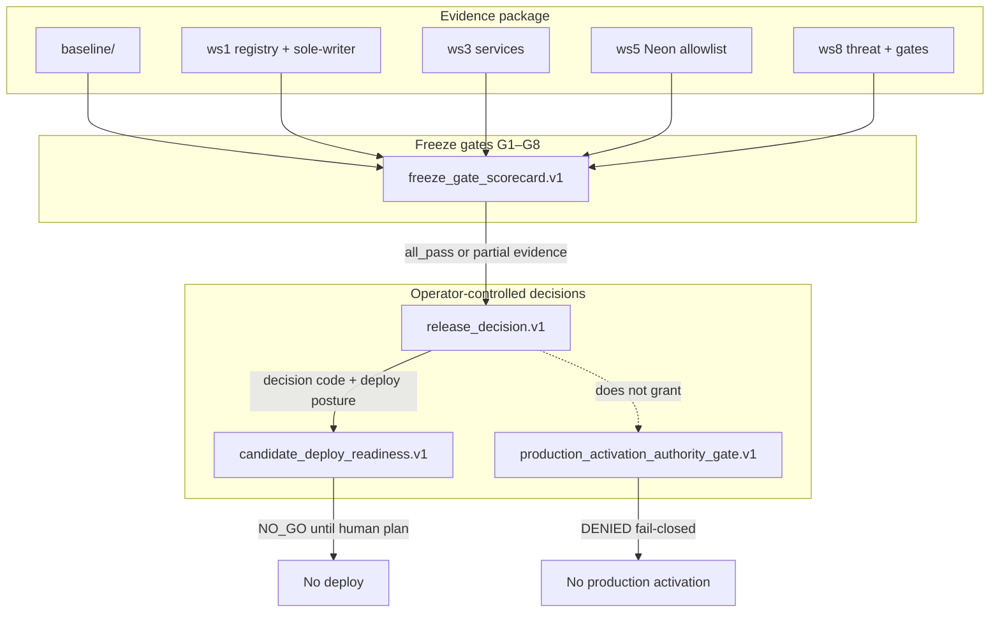

# Abraxas Production Readiness

```text
  evidence-gated · operator-controlled · fail-closed on authority
  RELEASE_HELD · deploy NO_GO · production activation DENIED
```

[](../../VERSION)
[](ws8/release_decision.v1.json)
[](ws8/production_activation_authority_gate.v1.json)
[](ws8/candidate_deploy_readiness.v1.json)
[](ws8/freeze_gate_scorecard.v1.json)
[](baseline/baseline_receipt.v1.json)
[](https://github.com/scrimshawlife-ctrl/Abraxas-v2.0/pull/971)

> **Canon rule:** This tree is the **repo-native source of truth** for the production-candidate track.
> It does **not** authorize production go-live. `RELEASE_HELD` means current repo-observed
> freeze evidence is not candidate-eligible; deploy remains **NO_GO** and **activation is DENIED**.

---

## Table of contents

1. [What this is](#what-this-is)
2. [Current posture (evidence)](#current-posture-evidence)
3. [Quickstart](#quickstart)
4. [Architecture](#architecture)
5. [Workstream map](#workstream-map)
6. [SUPPORTED surfaces](#supported-surfaces)
7. [Artifact catalog](#artifact-catalog)
8. [Operator runbook](#operator-runbook)
9. [Risk board](#risk-board)
10. [Development practices](#development-practices)
11. [Troubleshooting](#troubleshooting)
12. [Roadmap](#roadmap)
13. [Related docs](#related-docs)

---

## What this is

Abraxas is a governed symbolic-intelligence system. This package tracks **bounded production-candidate readiness** — not feature expansion and not autonomous activation.

| Term | Meaning here |
|------|----------------|
| **Evidence-gated** | Claims carry `evidence_state`: `Missing` \| `Partial` \| `Verified` \| `NOT_COMPUTABLE` |
| **SUPPORTED** | Public interface/service consumers may depend on (tests + ownership + contracts) |
| **ADVISORY** | Report-only / fail-open posture in CI unless operator promotes |
| **Fail-closed on authority** | Activation and deploy unhold require explicit human authority |
| **Candidate held** | Freeze eligible; **not** production ready; **not** deploy authorized |

**Primary plan:** [`CONTINUATION_PLAN.v16.md`](CONTINUATION_PLAN.v16.md) (production-readiness evidence refresh; supersedes v15)
**Debug plan (whole repo):** [`DEBUG_PLAN.v3.md`](DEBUG_PLAN.v3.md) (supersedes v2)
**Engineering guidebook:** [`docs/production_readiness/ENGINEERING_GUIDEBOOK.md`](../../docs/production_readiness/ENGINEERING_GUIDEBOOK.md)
**Landed:** [PR #971](https://github.com/scrimshawlife-ctrl/Abraxas-v2.0/pull/971) merged — still **not** production activation.

---

## Current posture (evidence)

| Signal | Value | Evidence |
|--------|--------|----------|
| Binding release decision | `RELEASE_HELD` | [`ws8/release_decision.v1.json`](ws8/release_decision.v1.json) |
| Readiness state | `NOT_READY` | same |
| Release `deploy_held` flag | `false` (no candidate deploy to hold) | same |
| Production activation | **`DENIED` / false** | [`ws8/production_activation_authority_gate.v1.json`](ws8/production_activation_authority_gate.v1.json) |
| Deploy readiness | **`NO_GO`** | [`ws8/candidate_deploy_readiness.v1.json`](ws8/candidate_deploy_readiness.v1.json) |
| Freeze scorecard | **7 PASS / 1 PARTIAL** | [`ws8/freeze_gate_scorecard.v1.json`](ws8/freeze_gate_scorecard.v1.json) |
| Baseline package | COMPLETE / **Partial** | [`baseline/baseline_receipt.v1.json`](baseline/baseline_receipt.v1.json) |
| Live fast CI (attached to baseline) | **not attached** in this refresh | baseline validation receipt |
| SUPPORTED interfaces | **4** | [`ws1/interface_registry_snapshot.v1.json`](ws1/interface_registry_snapshot.v1.json) |
| SUPPORTED services | **2** | [`ws3/service_registry.v1.json`](ws3/service_registry.v1.json) |
| Sole-writer advisory findings | **3** report-only findings (fail-closed **off**) | [`ws1/sole_writer_advisory_report.v1.json`](ws1/sole_writer_advisory_report.v1.json) |
| Notion Verified DoD | **Scoped** (6 rows Verified; overall NOT_READY) | [`ws8/notion_operator_verified_dod_receipt.v1.json`](ws8/notion_operator_verified_dod_receipt.v1.json) |

### What we do **not** claim

- Overall **Verified** production readiness
- Production go-live or marketing “ready”
- Fail-closed sole-writer / boundary in shared CI
- Complete WS0–WS10 simulation story as live repo fact (this tree documents **landed** workstreams only)

---

## Quickstart

### Prerequisites

- Python **3.12**
- Repo checkout with `.venv` recommended
- GitHub CLI optional (`gh`) for PR #971

```bash
cd /path/to/Abraxas-v2.0
python3.12 -m venv .venv
source .venv/bin/activate   # or: export PATH="$(pwd)/.venv/bin:$PATH"
pip install -e ".[dev]"     # project-specific extras if configured
```

### Essential commands

```bash
export PATH="$(pwd)/.venv/bin:$PATH"

# Mandatory validation entry (SUPPORTED)
python scripts/run_fast_ci.py

# Freeze scorecard + release decision (read/re-emit)
python scripts/readiness/run_freeze_gate_scorecard.py
python scripts/readiness/run_release_decision.py --help

# Deploy readiness (default NO_GO) + activation gate (DENIED)
python scripts/readiness/run_candidate_deploy_readiness.py
python scripts/readiness/run_production_activation_authority_gate.py

# SUPPORTED services
python scripts/runtime/run_validation_service.py --help
python scripts/artifact/run_artifact_provenance_service.py --help

# Notion mapping (repo-side; writeback is operator-gated)
python scripts/notion/run_notion_readiness_mapping.py

# Operator runbook (json + md)
python scripts/readiness/run_supported_surface_operator_runbook.py

# Docs crosslink check for this package
python scripts/readiness/run_production_readiness_docs_crosslink_check.py
```

### Focused tests

```bash
python -m pytest \
  tests/test_freeze_gate_scorecard.py \
  tests/test_release_decision.py \
  tests/test_production_activation_authority_gate.py \
  tests/test_candidate_deploy_readiness.py \
  tests/test_interface_registry.py \
  tests/test_service_registry.py \
  tests/test_validation_service.py \
  tests/test_artifact_provenance_service.py \
  -q
```

---

## Architecture

### Control flow (authority fail-closed)



### Layering

```text
┌─────────────────────────────────────────────────────────────┐
│ Operator authority (human)                                  │
│  · release decision · deploy unhold · activation token      │
├─────────────────────────────────────────────────────────────┤
│ SUPPORTED public surfaces                                   │
│  · canonical_json · run_fast_ci                             │
│  · validation_service.v1 · artifact_and_provenance_service  │
├─────────────────────────────────────────────────────────────┤
│ ADVISORY / report-only CI                                   │
│  · boundary · sole-writer · neon allowlist check            │
├─────────────────────────────────────────────────────────────┤
│ Evidence under out/production_readiness/                    │
│  · baseline · ws1 · ws2 · ws3 · ws5 · ws6 · ws8 · plans     │
└─────────────────────────────────────────────────────────────┘
```

**Sole-writer rule:** publication of `out/**` JSON should go through domain `scripts/<area>/run_*` runners (or SUPPORTED artifact service) using `core.canonical.json` — not ad-hoc core writers.

---

## Workstream map

Landed package directories (evidence in-repo). Names map to continuation plans, not a fictional WS0–WS10 completion certificate.

| Tree | Focus | Key artifacts |
|------|--------|----------------|
| **baseline/** | WS0 inventories + receipts | `baseline_receipt.v1.json`, inventories, risk register |
| **ws1/** | Interface registry, sole-writer, residual acceptance | `interface_registry_snapshot.v1.json` |
| **ws2/** | Writer triage, WP-D consolidations, D4 inventory, boundary design | `writer_debt_triage.v1.json`, `wp_d_consolidation_receipt.v1.json` |
| **ws3/** | Service registry | `service_registry.v1.json` |
| **ws5/** | Neon Genie capability allowlist | allowlist + check |
| **ws6/** | Soft CI gate audit + disposition | keep soft / no fail-closed promo |
| **ws8/** | Threat model, Notion, freeze, release, deploy, activation, runbook | decision + gate JSONs |
| **CONTINUATION_PLAN.v1–v16.md** | Ordered program plans | active: **v16** |

<details>
<summary><strong>Continuation plan history (click)</strong></summary>

| Plan | Theme |
|------|--------|
| v1–v3 | Baseline → services → Wave 1 |
| v4–v5 | Notion mapping, SUPPORTED promotions, recovery |
| v6 | Freeze scorecard + residual accept + RELEASE_HELD |
| v7 | I+ historical candidate approval, deploy-held |
| v8 | Deploy NO_GO, activation DENIED, runbook, D4 inventory |
| v9–v10 | D4 pure builders + tech debt closeout (unauthorized=0) |
| v11–v15 | Post-debt hygiene, scripts organization, and DX closeout |
| v16 | Production-readiness evidence refresh to `RELEASE_HELD` / `NOT_READY` |

</details>

---

## SUPPORTED surfaces

| Contract / service | Stability | How to exercise |
|--------------------|-----------|-----------------|
| `canonical_json` | SUPPORTED | Library: `core.canonical.json` |
| `run_fast_ci` | SUPPORTED | `python scripts/run_fast_ci.py` |
| `validation_service.v1` | SUPPORTED | `python scripts/runtime/run_validation_service.py` |
| `artifact_and_provenance_service.v0` | SUPPORTED | `python scripts/artifact/run_artifact_provenance_service.py` |

Full inventory: [`ws8/supported_surface_freeze_inventory.v1.json`](ws8/supported_surface_freeze_inventory.v1.json)
Procedures: [`ws8/supported_surface_operator_runbook.v1.md`](ws8/supported_surface_operator_runbook.v1.md)

---

## Artifact catalog

### Baseline (`baseline/`)

| File | Role |
|------|------|
| `baseline_receipt.v1.json` | Package status + validation attachment |
| `baseline_manifest.v1.json` | Exit-criteria map |
| `readiness_blockers.v1.json` | Program risk board |
| `*inventory*.json` | Schema/interface/writer/test inventories |

### Kernel / services

| Path | Role |
|------|------|
| `ws1/interface_registry_snapshot.v1.json` | Stability classes + SUPPORTED set |
| `ws1/sole_writer_advisory_report.v1.json` | Advisory residual writers |
| `ws3/service_registry.v1.json` | Service candidates + SUPPORTED |

### Ops / authority (`ws8/`)

| File | Role |
|------|------|
| `threat_model.v0.json` | Partial threat model |
| `threat_model_operator_decision_record.v0.json` | ACCEPT_PARTIAL_BASELINE |
| `freeze_gate_scorecard.v1.json` | G1–G8 |
| `release_decision.v1.json` | Binding release code |
| `candidate_deploy_readiness.v1.json` | Deploy go/no-go |
| `production_activation_authority_gate.v1.json` | Activation DENIED |
| `notion_*` | Mapping + writeback receipts |
| `recovery_drill.v0.json` | Critical path git restorability |

**Provenance fields** (typical): `schema_version`, `produced_at`, `producer`, `repository_sha`, `evidence_state`.

---

## Operator runbook

See [`ws8/supported_surface_operator_runbook.v1.md`](ws8/supported_surface_operator_runbook.v1.md).

### Safety rules (binding)

1. Do **not** set `production_activation_authorized=true` without WP-AUTH process
2. Do **not** enable `ABRAXAS_BOUNDARY_FAIL_CLOSED` without operator approval
3. Prefer domain `scripts/<area>/run_*` runners + SUPPORTED services for `out/` writes
4. Advance Notion Evidence State to **Verified** only with durable DoD links

### Deploy still missing (NO_GO)

From deploy readiness checklist:

- Human deploy + rollback plan
- Environment / secrets attestation
- Explicit deploy **unhold** decision (separate from release-decision evidence)

---

## Risk board

Summarized from baseline blockers (see full JSON for mitigations):

| ID | Typical status | Theme |
|----|----------------|--------|
| RISK-006 | CLOSED when live CI attached | Live validation |
| RISK-008 | MITIGATING | Boundary / sole-writer advisory |
| RISK-010 / 011 | MITIGATING | Services + SUPPORTED set |
| RISK-012 | MITIGATING | Notion linkage / writeback residual |
| RISK-013 | MITIGATING | Neon allowlist |
| RISK-014 | MITIGATING | Threat model Partial |
| RISK-004 | OPEN (P1) | Historical archive surfaces |

---

## Development practices

### Stability classes

| Class | Consumer expectation |
|-------|----------------------|
| **SUPPORTED** | Depend with semver discipline; tests required |
| **ADVISORY** | May change; CI often report-only |
| **INTERNAL** | No external contract |
| **EXPERIMENTAL** | Candidate / incomplete |

### PR hygiene (this track)

- Small reversible PRs on readiness branch
- Re-pin artifacts after generators with preserved live CI validation when possible
- Never fabricate CI outcomes (`--with-fast-ci` or prior validation JSON only)
- Force-add readiness JSON under `out/` when `.gitignore` ignores `out/**/*.json`

### Extension guide

1. Add generator under `core/production_readiness/`
2. Add domain `scripts/<area>/run_*` sole-writer
3. Add schema under `contracts/production_readiness/` when needed
4. Add tests under `tests/test_*.py`
5. Emit under `out/production_readiness/`
6. Update this README + CONTINUATION plan
7. Extend recovery drill critical paths if artifact is freeze-critical

---

## Troubleshooting

| Symptom | Check |
|---------|--------|
| Fast CI drift exit 3 | Dirty worktree / advisory rewrites under pytest; use clean tree |
| `.venv/bin/python` missing in tests | `export PATH="$(pwd)/.venv/bin:$PATH"` |
| check-organization fails | Move unorganized root `run_*` under domain dirs (`scripts/ingest/`, `scripts/artifact/`, …) |
| G1 PARTIAL after re-pin | Baseline regenerated without validation — re-attach via `--validation-json` |
| Scorecard recommends CANDIDATE but you want hold | Binding decision is `release_decision.v1.json`, not recommendation alone |
| Activation “approved” by mistake | Gate producer does **not** honor tokens automatically; status remains DENIED |

---

## Roadmap

| Priority | Item | Notes |
|----------|------|--------|
| Optional | Merge PR #971 when checks green | Engineering merge ≠ activation |
| Optional | Human deploy plan | Required before deploy unhold |
| Done (scoped) | Notion Verified DoD | 6 checkpoints; hub remains NOT_READY |
| Current | Production readiness evidence refreshed to `RELEASE_HELD` / `NOT_READY`; activation DENIED | #1123 maintenance |
| Hard no (default) | Fail-closed sole-writer in CI | Only after operator approval |
| Hard no (default) | Production activation | Separate dual-control process |

---

## Related docs

| Doc | Role |
|-----|------|
| [`docs/production_readiness/ENGINEERING_GUIDEBOOK.md`](../../docs/production_readiness/ENGINEERING_GUIDEBOOK.md) | Full engineering guidebook for this track |
| [`docs/production_readiness/INDEX.md`](../../docs/production_readiness/INDEX.md) | Doc index |
| [`docs/START_HERE.md`](../../docs/START_HERE.md) | Contributor front door |
| [`ARCHITECTURE.md`](../../ARCHITECTURE.md) | System architecture |
| [`STATUS.md`](../../STATUS.md) | Live repo status |
| [`COMPATIBILITY.md`](../../COMPATIBILITY.md) | Public compatibility surface |
| [`ws8/supported_surface_operator_runbook.v1.md`](ws8/supported_surface_operator_runbook.v1.md) | Operational procedures |

---

## Contributing / license

- Follow root [`README.md`](../../README.md) and [`AGENTS.md`](../../AGENTS.md)
- Governance: operator-controlled; no autonomous production activation
- License: see repository root license file

---

*Generated/maintained for the production-candidate track. Evidence-gated. Not a production go-live certificate.*
